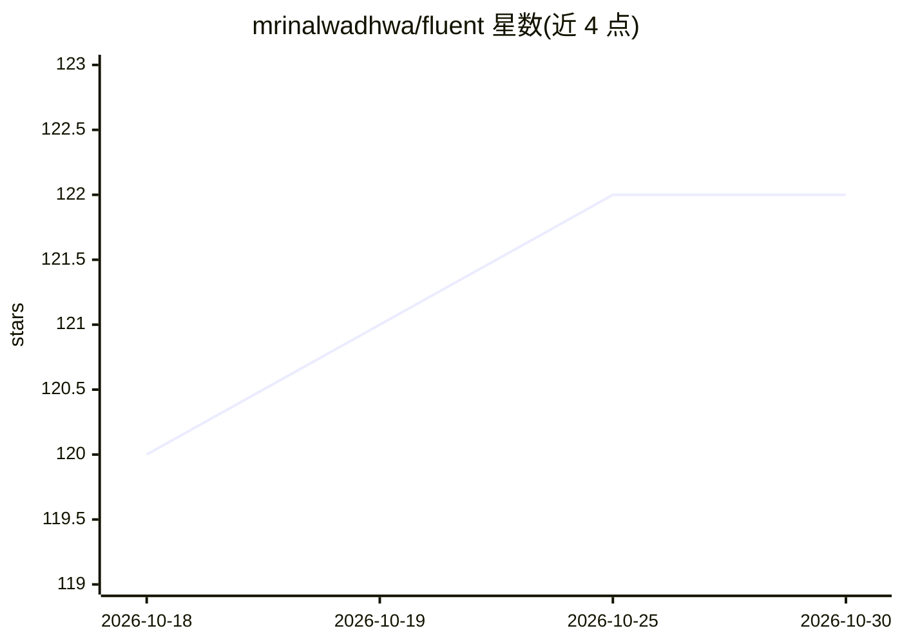

# mrinalwadhwa/fluent

⭐ 122 · Rust · Apache-2.0 · 推送 2026-10-11 · [GitHub](https://github.com/mrinalwadhwa/fluent) · [官网](https://fluent.computer) · 个人维护

**自主软件工厂：把愿景、反馈与日志经多 agent 变成可用软件**

Fluent 通过技能（skill）形式嵌入 Codex、Claude Code、Pi 等编码 agent 使用。它将 agent 痕迹、生产日志、用户反馈与团队想法记录为 Observation，经对话塑形为 Brief、行为规范（EARS 语法）、技术方案与实现计划，再由调度器委派 Writer、Tester、Reviewer、Learner 等 agent 执行，人可介入决策或授权合并，委派工作可本地或远程运行。安装方式为 npx skills add，目前仅支持 macOS。

## 筛选速览

| 维度 | 判定 | 备注 |
|---|---|---|
| AI 角色 | `ai-ecosystem` | LLM/agent 周边工具 |
| 许可风险 | `permissive` | Apache-2.0 |
| 部署形态 | `library` | 以包/库形式分发 |
| 模型依赖 | — | README 未给出锁定关系 |
| 硬件要求 | — | 无带数字的原话,不猜 |
| 安装摩擦 | `low` | 无编译、无系统依赖或容器化 |
| 成熟度 | — | 结构信号不足 |

## 能力要点

- Observation→Brief→EARS 行为规范→实现计划的分层工作流
- Writer/Tester/Reviewer/Learner 多 agent 委派与两条概念队列调度
- 人机分工：需人类判断的工作进入人工队列，其余由 agent 执行
- 以技能形式驱动 Codex / Claude Code / Pi 等编码 agent

## 适用场景

- 团队把想法、bug 报告和用户反馈持续转化为工作软件
- 在编码 agent 中以对话方式记录并塑形开发任务
- 委派多 agent 执行实现、测试与评审并保留人工授权合并

## 场景标签

`多智能体` `编码 Agent` · 领域:Agent 开发

## 证据(README 行号)

> L5:  The Fluent skill lets you drive the factory by chatting with Codex, Claude Code, or another coding agent. Agent tra
> L7: You use the factory through the Fluent skill in Codex, Claude Code, Pi, or another coding agent that supports skills

## 星数曲线

2026-10-18 120 → 2026-10-30 122（+2）

---
*卡片 v1 · prompt 1.4 · 生成 2026-10-23 · 置信度 high · 依据 README sha `73da62988143` · [字段定义](../../DATASET.md)*
