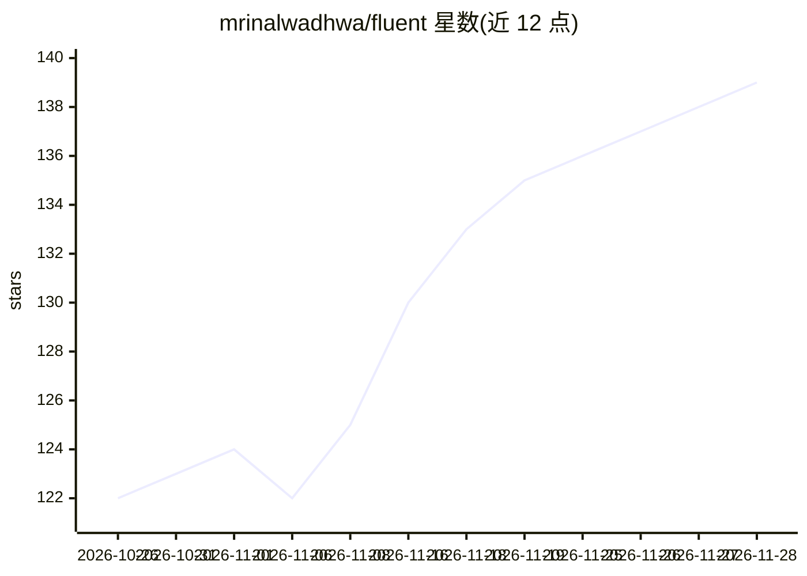

# mrinalwadhwa/fluent

⭐ 139 · Rust · Apache-2.0 · 推送 2026-11-11 · [GitHub](https://github.com/mrinalwadhwa/fluent) · [官网](https://fluent.computer) · 个人维护

**通过编码代理驱动的自改进软件工厂：把想法与反馈变成可用软件**

Fluent 以技能（skill）形式安装在 Codex、Claude Code、Pi 等支持 skills 的编码代理中，把团队愿景、bug 报告、用户反馈、生产日志与 agent 轨迹转化为 Observation，经对话塑形为 Work Item，由调度器分派给 Writer、Tester、Reviewers 和 Learner 等角色，形成审查回写、Expertise 沉淀的自闭环。需求描述采用 EARS 语法，每条行为需绑定测试引用；合并且部署后可持续观察生产活动。当前仅支持 macOS，通过 npx 安装，升级含二进制校验。

## 筛选速览

| 维度 | 判定 | 备注 |
|---|---|---|
| AI 角色 | `ai-native` | 本体是模型或模型工具 |
| 许可风险 | `permissive` | Apache-2.0 |
| 部署形态 | `library` | 以包/库形式分发 |
| 模型依赖 | — | README 未给出锁定关系 |
| 硬件要求 | — | 无带数字的原话,不猜 |
| 安装摩擦 | `low` | 无编译、无系统依赖或容器化 |
| 成熟度 | — | 结构信号不足 |

## 能力要点

- 以 skill 形式接入 Codex / Claude Code / Pi 等编码代理，对话即操作界面
- Observation → Work Item 的双队列机制：人工决策队列与代理算力队列独立推进
- 多角色流水线（Writer/Tester/Reviewers/Learner）与 Expertise 沉淀复用
- 行为规格采用 EARS 语法，每条行为附带 Test 引用或 Untestable 理由

## 适用场景

- 把 bug 报告、用户反馈、生产日志持续转化为待办工作项并自动实现
- 通过对话逐步塑形功能切片（Brief→行为规格→技术方案→实施计划）
- 代理自主排队执行任务，需要人工判断时再拉人介入

## 场景标签

`编码 Agent` `多智能体` · 领域:Agent 开发

## 证据(README 行号)

> L3: Fluent is a factory that autonomously turns your team's vision, ideas, bug reports, user feedback, production logs, 
> L5:  The Fluent skill lets you drive the factory by chatting with Codex, Claude Code, or another coding agent. Agent tra
> L7: You use the factory through the Fluent skill in Codex, Claude Code, Pi, or another coding agent that supports skills

## 星数曲线

2026-10-26 122 → 2026-11-28 139（+17）

---
*卡片 v1 · prompt 1.4 · 生成 2026-11-27 · 置信度 high · 依据 README sha `b55d431bf55b` · [字段定义](../../DATASET.md)*
