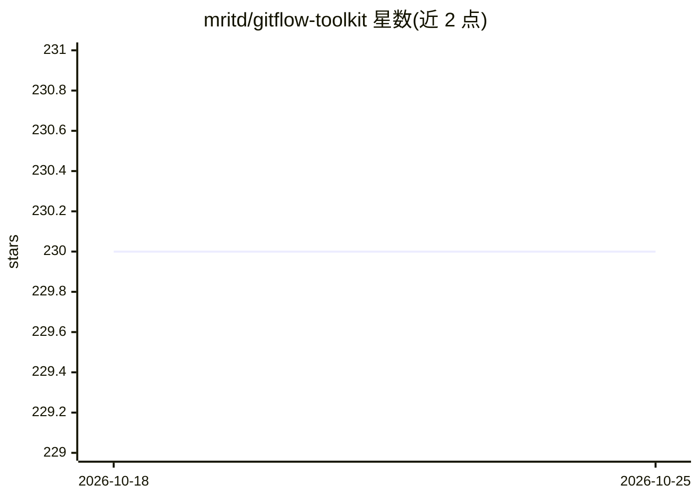

# mritd/gitflow-toolkit

⭐ 230 · Go · MIT · 推送 2026-09-10 · [GitHub](https://github.com/mritd/gitflow-toolkit) · 个人维护 · 中文 README

**Go 编写的 GitFlow CLI：交互式生成 Conventional Commits 提交信息**

GitFlow Toolkit 是用 Go 编写的 CLI 工具，按 Conventional Commits 1.0.0 规范标准化 git 提交信息。提供交互式 TUI 创建提交、分支，通过 git 子命令（git ci/ps/feat 等）操作，支持按分支名自动推断提交类型、指定 commit hash 前缀（lucky commit，需外部 cargo 安装 lucky_commit）。AI 功能为调用 LLM（OpenRouter/Groq/Ollama/OpenAI 兼容接口）自动生成提交信息，可输出英文/中文/双语。要求 Git 与 macOS/Linux，Windows 未充分测试。通过 Homebrew、二进制或 go install 安装。

## 筛选速览

| 维度 | 判定 | 备注 |
|---|---|---|
| AI 角色 | `ai-enhanced` | 去掉 AI 部分产品仍成立 |
| 许可风险 | `permissive` | MIT |
| 部署形态 | `desktop` | 安装包/桌面程序 |
| 模型依赖 | local-ok | 支持本地模型 |
| 硬件要求 | — | 无带数字的原话,不猜 |
| 安装摩擦 | `low` | 无编译、无系统依赖或容器化 |
| 成熟度 | — | 结构信号不足 |

## 能力要点

- 交互式 TUI 按 Conventional Commits 1.0.0 生成提交信息
- LLM 自动生成提交信息（OpenRouter/Groq/Ollama/OpenAI 兼容）
- git 子命令集成（git ci/ps/feat/fix 等 12 类分支命令）
- 按分支名自动推断提交类型，支持 lucky commit hash 前缀

## 适用场景

- 在交互式 TUI 中快速写出规范的 Conventional Commits 信息
- 让 LLM 根据 diff 自动生成提交信息并审阅/修改
- 按 feat/fix/docs 等前缀统一管理分支创建流程

## 场景标签

 · 领域:开发工具/Git 工作流

## 证据(README 行号)

> L3: GitFlow Toolkit is a CLI tool written in Go for standardizing git commit messages following the Conventional Commits
> L10: - AI-powered commit message generation (OpenRouter, Groq, OpenAI, Ollama)

## 星数曲线

2026-10-18 230 → 2026-10-25 230（+0）

---
*卡片 v1 · prompt 1.4 · 生成 2026-10-22 · 置信度 high · 依据 README sha `11e40063e599` · [字段定义](../../DATASET.md)*
