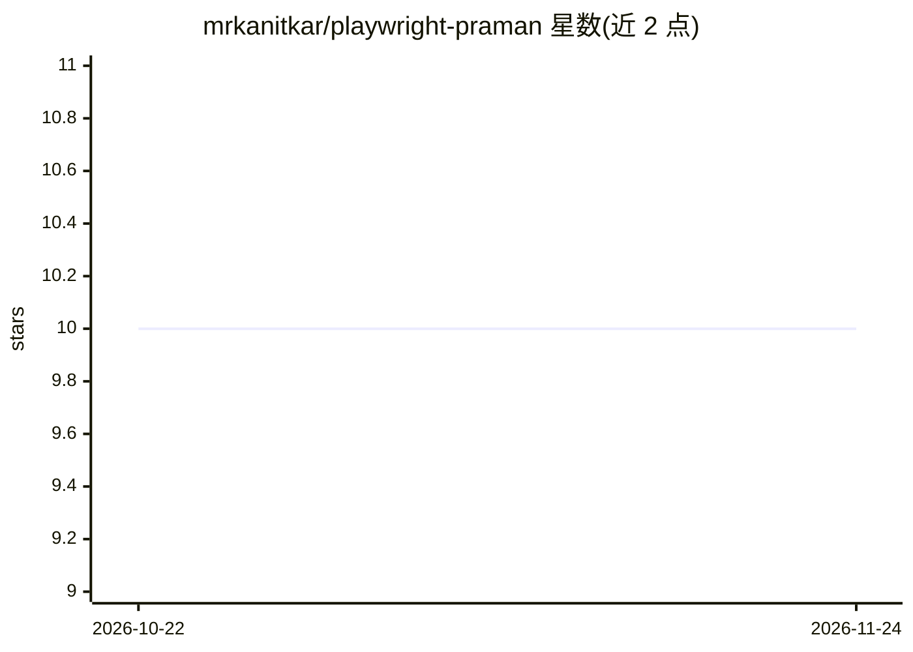

# mrkanitkar/playwright-praman

⭐ 10 · TypeScript · Apache-2.0 · 推送 2026-11-05 · [GitHub](https://github.com/mrkanitkar/playwright-praman) · [官网](http://praman.dev/) · 个人维护

**面向 SAP 测试工程师的 UI5 Playwright 测试自动化插件**

以 Playwright 插件形式提供的 SAP UI5 测试自动化工具，通过 UI5 runtime registry 查询控件而非 DOM 选择器，覆盖 199 种 UI5 控件类型，支持 OData V2/V4 请求拦截与断言、Fiori Elements 辅助函数、10 个 UI5 专属 expect 匹配器。AI 部分为 plan→generate→heal 三个 Agent：探索 SAP 系统生成测试计划、转换为类型化 Playwright 代码、运行并自动修复直至通过；也可完全手写测试。需 Node.js ≥22、Playwright ≥1.57，支持 Windows/macOS/Linux，Apache-2.0 许可。

## 筛选速览

| 维度 | 判定 | 备注 |
|---|---|---|
| AI 角色 | `ai-enhanced` | 去掉 AI 部分产品仍成立 |
| 许可风险 | `permissive` | Apache-2.0 |
| 部署形态 | `library` | 以包/库形式分发 |
| 模型依赖 | — | README 未给出锁定关系 |
| 硬件要求 | — | 无带数字的原话,不猜 |
| 安装摩擦 | `low` | 无编译、无系统依赖或容器化 |
| 成熟度 | — | 结构信号不足 |

## 能力要点

- 通过 UI5 runtime registry 查询控件，无需依赖 DOM 选择器
- plan→generate→heal AI Agent 管线从业务流程描述生成并自愈测试
- 覆盖 199 种 UI5 控件类型与 OData V2/V4 请求断言
- 提供 MCP 与 CLI 两种 Agent 接入方式

## 适用场景

- 为 S/4HANA 或 Fiori 应用编写端到端测试
- 用 AI 从业务流程描述生成 SAP 测试脚本
- 替代手工 SAP 测试脚本编写
- 对 OData 后端请求做 mock、拦截与断言

## 场景标签

`浏览器自动化` `编码 Agent` · 领域:效率与自动化

## 证据(README 行号)

> L3: > Agent-First SAP UI5 Test Automation Plugin for Playwright
> L62: Describe your business process. Praman's **plan → generate → heal** pipeline does the rest.
> L81: ```typescript

## 星数曲线



2026-10-22 10 → 2026-11-24 10（+0）


---
*卡片 v1 · prompt 1.4 · 生成 2026-11-19 · 置信度 high · 依据 README sha `93e45dca625c` · [字段定义](../../DATASET.md)*
