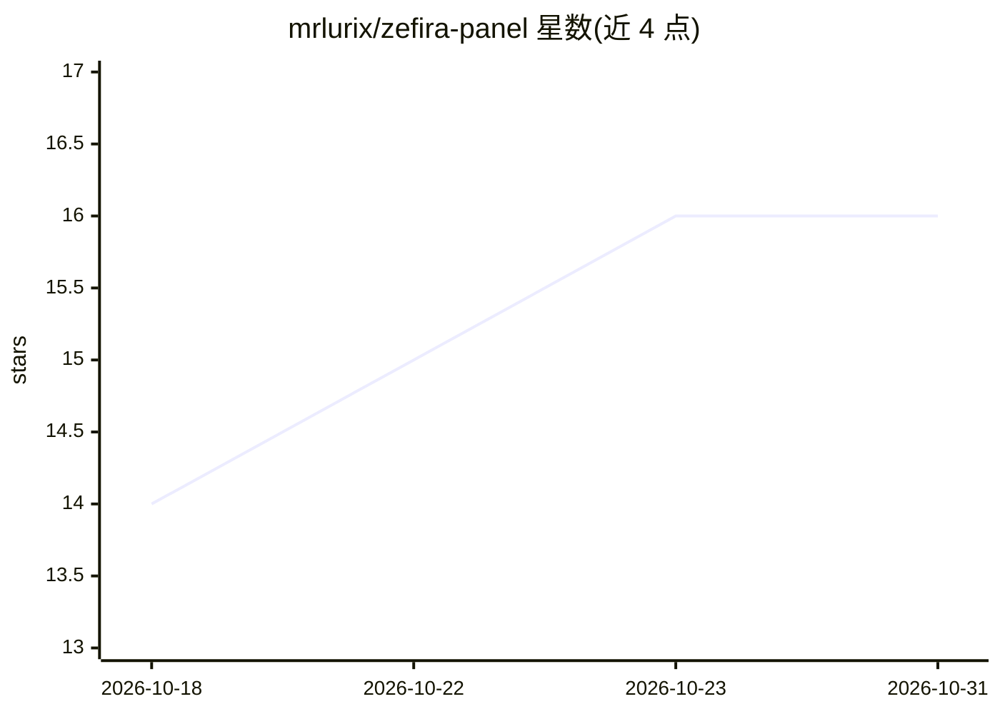

# mrlurix/zefira-panel

⭐ 16 · Python · MIT · 推送 2026-10-29 · [GitHub](https://github.com/mrlurix/zefira-panel) · [官网](https://mrlurix.github.io/zefira-panel/) · 个人维护 · 中文 README

**多协议 VPN 账号销售管理面板，附带 AI 助手**

基于 FastAPI + SQLite 的 VPN 账号管理与销售面板，支持 VLESS-REALITY、VMess、Trojan、Shadowsocks、Hysteria2、WireGuard、OpenVPN、L2TP/IPsec、Cisco AnyConnect、SOCKS5 等协议，单用户多协议合并为一条订阅链接，支持 base64 与 Clash YAML 格式。提供用户流量限制、节点健康检查、BackPack 隧道管理、作用域 API 令牌、二维码与配置打包下载、四语言界面。AI 部分为面板内的助手气泡（Groq 优先，支持 OpenAI/Anthropic/Gemini/Ollama）。通过一键安装脚本或手动 pip 安装，强制单 worker 运行。

## 筛选速览

| 维度 | 判定 | 备注 |
|---|---|---|
| AI 角色 | `ai-enhanced` | 去掉 AI 部分产品仍成立 |
| 许可风险 | `permissive` | MIT |
| 部署形态 | `library` | 以包/库形式分发 |
| 模型依赖 | — | README 未给出锁定关系 |
| 硬件要求 | — | 无带数字的原话,不猜 |
| 安装摩擦 | `low` | 无编译、无系统依赖或容器化 |
| 成熟度 | — | 结构信号不足 |

## 能力要点

- 支持 10 种 VPN 协议，单用户多协议合并订阅（含 Clash YAML 格式）
- BackPack v1.8.5 隧道管理：流量上限、重启计划、备份地址故障转移
- 作用域 API 令牌（zfp_…）供 Telegram 机器人与仪表盘调用
- 61 个测试套件覆盖功能、安全与前端逻辑

## 适用场景

- 在 VPS 上搭建并出售 VPN 账号，管理用户流量与到期时间
- 通过订阅链接向客户分发多协议配置（含 Clash 格式）
- 管理伊朗/海外服务器间的 BackPack 隧道并设置流量上限

## 场景标签

`AI 助手` · 领域:对话与助手

## 证据(README 行号)

> L11: Simple panel for managing and selling VPN accounts. Started as a private tool for my own servers and cleaned up for
> L13: Works with VLESS, VLESS-REALITY, VMess, Trojan, Shadowsocks, Hysteria2, WireGuard, OpenVPN, L2TP/IPsec, Cisco AnyCo
> L110: - AI assistant bubble: panel-only helper (Groq-first, OpenAI/Anthropic/Gemini/Ollama) for beginners.

## 星数曲线

2026-10-18 14 → 2026-10-31 16（+2）

---
*卡片 v1 · prompt 1.4 · 生成 2026-10-30 · 置信度 high · 依据 README sha `e0d890ce7dd0` · [字段定义](../../DATASET.md)*
