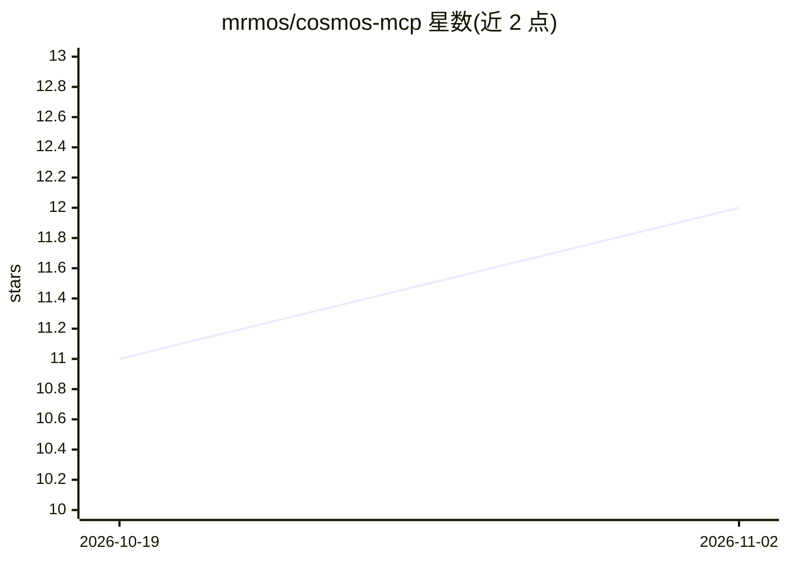

# mrmos/cosmos-mcp

⭐ 12 · TypeScript · MIT · 推送 2026-08-05 · [GitHub](https://github.com/mrmos/cosmos-mcp) · [官网](https://www.npmjs.com/package/cosmos-mcp) · 个人维护

**给 AI 客户端用的 cosmos.so 非官方 MCP 服务器：搜索与收藏视觉素材**

cosmos.so 视觉发现站的非官方 MCP 服务器，让 Claude、Cursor 等 MCP 客户端中的 agent 通过 30+ 工具搜索公共元素/合集/用户、以图找相似图、浏览策展合集，并在认证后创建合集、保存与整理元素。读取无需配置；写操作复用用户自己的浏览器会话 Bearer token，无 OAuth 与权限范围。关键限制：Cosmos 无公开 API，服务器调用其私有 GraphQL 端点，端点变更即可能失效；通过 npx 分发，需自担 ToS 风险。

## 筛选速览

| 维度 | 判定 | 备注 |
|---|---|---|
| AI 角色 | `ai-ecosystem` | LLM/agent 周边工具 |
| 许可风险 | `permissive` | MIT |
| 部署形态 | `library` | 以包/库形式分发 |
| 模型依赖 | locked-api |  |
| 硬件要求 | — | 无带数字的原话,不猜 |
| 安装摩擦 | `low` | 无编译、无系统依赖或容器化 |
| 成熟度 | `idea` | |

## 能力要点

- 30+ MCP 工具覆盖搜索、以图找相似、合集创建与整理、账户操作
- 搜索与浏览无需认证，写操作复用浏览器会话 token
- cosmos_view_images 将元素作为真实图像返回供模型查看
- npx 一条命令接入 Claude Code，统一 JSON 配置支持任意 MCP 客户端

## 适用场景

- 让 Claude/Cursor 中的 agent 按一句话自动搭建视觉情绪板
- 从一张图出发找视觉相似素材并整理进合集
- 把已保存的素材归档整理到既有合集

## 场景标签

`语义搜索` · 领域:知识与检索

## 证据(README 行号)

> L7: **Build moodboards with an AI agent.** cosmos-mcp is an unofficial Model Context Protocol server for cosmos.so, the 
> L33: The server gives an agent tools for that model. In one turn, an agent can:
> L231: The server speaks MCP over stdio. Anything on stdout that is not a JSON-RPC frame corrupts the protocol, so log to

## 星数曲线

2026-10-19 11 → 2026-11-02 12（+1）

---
*卡片 v1 · prompt 1.4 · 生成 2026-11-02 · 置信度 high · 依据 README sha `15eff3812804` · [字段定义](../../DATASET.md)*
