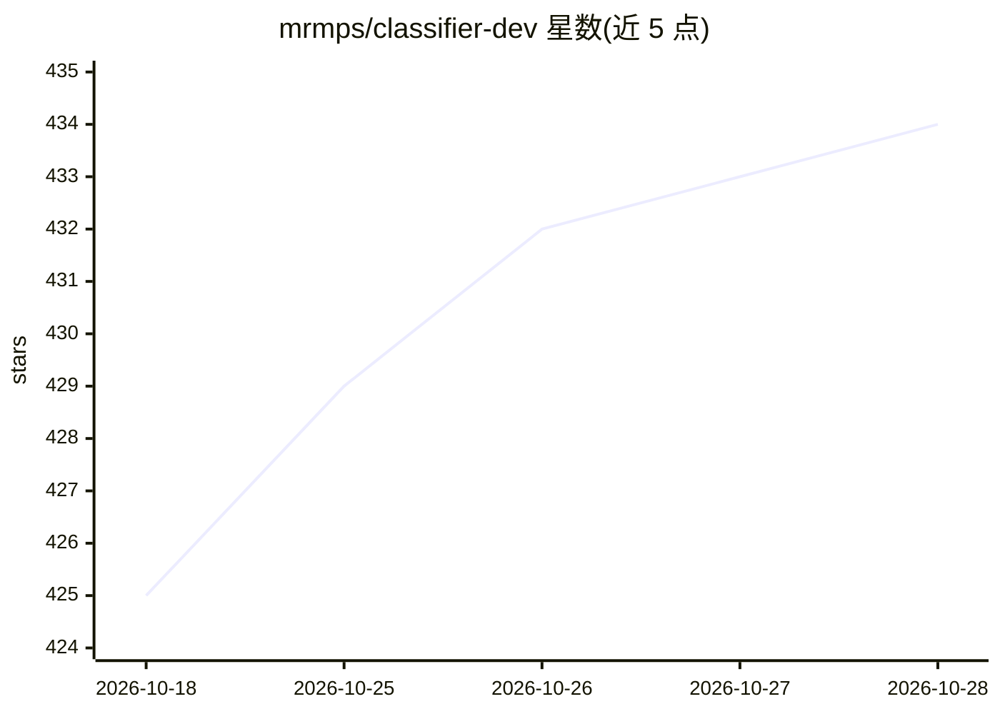

# mrmps/classifier-dev

⭐ 434 · TypeScript · MIT · 推送 2026-10-19 · [GitHub](https://github.com/mrmps/classifier-dev) · [官网](https://classifier.dev) · 个人维护

**免 Key 的零样本文本分类 HTTP API、CLI 与 MCP 服务**

运行在单个 Cloudflare Worker 上的零样本文本分类服务：输入文本与候选标签，输出标签与校准置信度，无需 API key 或注册，单请求最多一千条文本。核心模型为 TypeSafe 的 Jev 决策模型，LLM 链作为后备；提供 npm CLI（classifier-dev）、MCP server、多标签一次完成、长上下文分块处理、agent feedback 协议接入与每 IP 限流。部署需 Cloudflare 账号及多个上游 API secret。

## 筛选速览

| 维度 | 判定 | 备注 |
|---|---|---|
| AI 角色 | `ai-native` | 本体是模型或模型工具 |
| 许可风险 | `permissive` | MIT |
| 部署形态 | `library` | 以包/库形式分发 |
| 模型依赖 | — | README 未给出锁定关系 |
| 硬件要求 | — | 无带数字的原话,不猜 |
| 安装摩擦 | `low` | 无编译、无系统依赖或容器化 |
| 成熟度 | — | 结构信号不足 |

## 能力要点

- 零样本分类：文本进、标签+校准置信度出，无需 key/注册
- 单请求支持最多一千条文本，批量一次上游调用
- Jev 决策模型为主，LLM 链后备；smart 档对低置信结果二次询问
- 提供 npm CLI 与 MCP server，实现 feedback.now agent 反馈协议

## 适用场景

- 用一行 curl 给文本打标签（如垃圾/非垃圾、bug/feature）
- 在 agent 或流水线中通过 MCP 接入零样本分类
- 批量给反馈、新闻标题等文本做单标签或多标签分类

## 场景标签

 · 领域:文本分类/API 服务

## 证据(README 行号)

> L3: Zero-shot text classification. Plain text in, a label and a calibrated
> L6:  curl https://classifier.dev/spam,not+spam/Win+a+free+iPhone

## 星数曲线

2026-10-18 425 → 2026-10-28 434（+9）

---
*卡片 v1 · prompt 1.4 · 生成 2026-10-23 · 置信度 high · 依据 README sha `89e371599811` · [字段定义](../../DATASET.md)*
