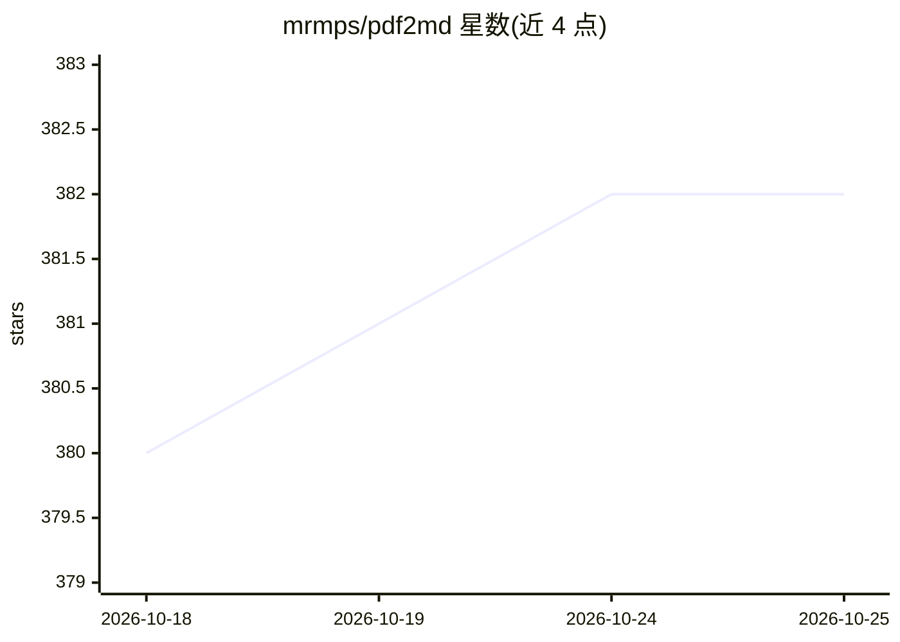

# mrmps/pdf2md

⭐ 382 · TypeScript · 推送 2026-07-04 · [GitHub](https://github.com/mrmps/pdf2md) · [官网](https://www.pdftomarkdown.co) · 个人维护

**浏览器本地运行的 PDF 转 Markdown 工具，无文件上传**

基于 NextJS 构建的网页应用，调用 @opendocsg/pdf2md 库在浏览器本地完成 PDF 到 Markdown 的转换：提取标题、列表、表格、粗斜体等基础格式并输出 Markdown，可下载或复制。全程无服务端处理、无上传与存储，加载后可离线使用，建议文件小于 10MB；复杂布局与图片可能不被完整保留。面向开发者和写作人员，通过 git clone 后以 pnpm/npm/yarn 安装依赖并启动开发服务器运行。

## 筛选速览

| 维度 | 判定 | 备注 |
|---|---|---|
| AI 角色 | `ai-enhanced` | 去掉 AI 部分产品仍成立 |
| 许可风险 | `none` | — |
| 部署形态 | `library` | 以包/库形式分发 |
| 模型依赖 | — | README 未给出锁定关系 |
| 硬件要求 | — | 无带数字的原话,不猜 |
| 安装摩擦 | `low` | 无编译、无系统依赖或容器化 |
| 成熟度 | — | 结构信号不足 |

## 能力要点

- 全部处理在浏览器本地完成，无上传无存储
- 支持标题、列表、表格、粗斜体等基础格式转换
- 加载后可离线使用，兼容主流现代浏览器
- 基于 @opendocsg/pdf2md 库构建，MIT 许可

## 适用场景

- 把 PDF 文档转成 Markdown 用于写作或笔记
- 在不上传文件的前提下处理含敏感内容的 PDF
- 为 RAG/知识库准备 Markdown 格式的文本素材

## 场景标签

`文档解析` · 领域:知识与检索

## 证据(README 行号)

> L3: Convert PDF files to Markdown instantly, securely, and 100% in your browser. No uploads, no privacy worries—just fas
> L25: 2. **Conversion**: The app uses the `@opendocsg/pdf2md` library to extract text, structure, and formatting from you

## 星数曲线

2026-10-18 380 → 2026-10-25 382（+2）

---
*卡片 v1 · prompt 1.4 · 生成 2026-10-21 · 置信度 low · 依据 README sha `f447464d3995` · [字段定义](../../DATASET.md)*
