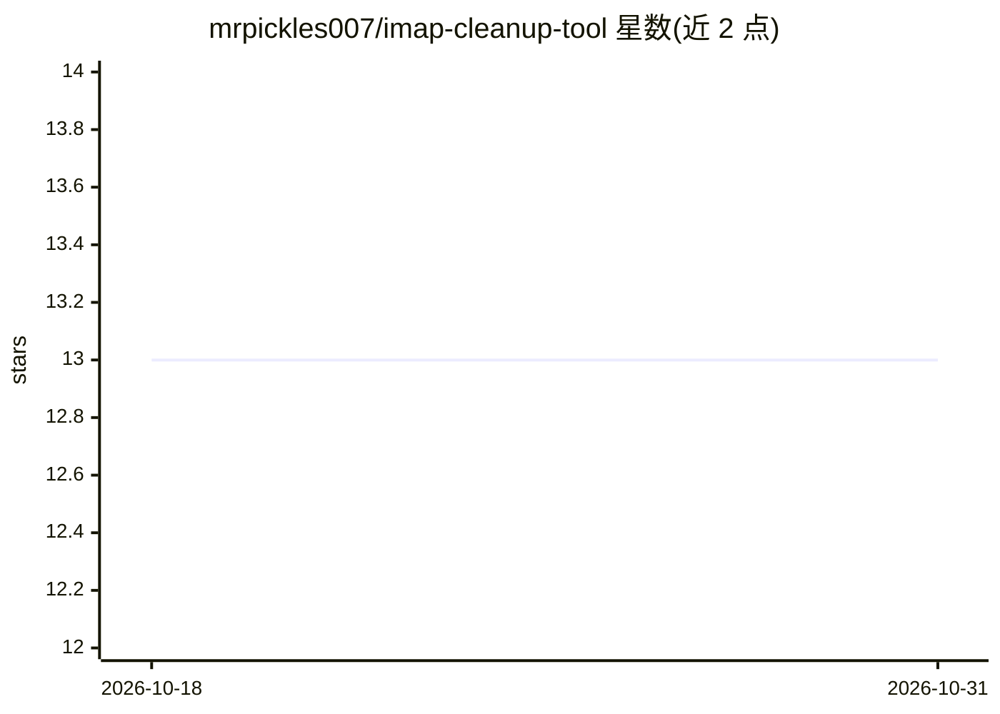

# mrpickles007/imap-cleanup-tool

⭐ 13 · Python · AGPL-3.0 · 推送 2026-09-30 · [GitHub](https://github.com/mrpickles007/imap-cleanup-tool) · [官网](https://pypi.org/project/imap-cleanup-tool/) · 个人维护

**按发件人/域名/规则或 AI 批量清理 IMAP 邮箱的 CLI 与本地 Web 工具**

面向终端用户的邮箱清理工具，通过 IMAP 批量删除或移动邮件，提供 CLI 与本地 Web GUI，CLI 仅用 Python 标准库。AI 清理为可选功能：本地启发式给发件人打垃圾邮件分，LLM 判定后删除；模型自选——本地 Ollama 或自带 API key 的云端模型（OpenAI/OpenRouter 等），只发送发件人主题与统计信息，不发送邮件正文。无 AI 时发件人/域名/嵌套规则过滤、mbox 导入导出、定时任务、批量退订等均可独立使用。Windows/Linux 提供一键安装包，macOS 经 pip 安装。

## 筛选速览

| 维度 | 判定 | 备注 |
|---|---|---|
| AI 角色 | `ai-enhanced` | 去掉 AI 部分产品仍成立 |
| 许可风险 | `viral` | AGPL-3.0 |
| 部署形态 | `desktop` | 安装包/桌面程序 |
| 模型依赖 | local-ok | 支持本地模型 |
| 硬件要求 | — | 无带数字的原话,不猜 |
| 安装摩擦 | `low` | 无编译、无系统依赖或容器化 |
| 成熟度 | — | 结构信号不足 |

## 能力要点

- AI 清理：本地启发式打分 + LLM 判定，支持本地 Ollama 或 BYOA 云端模型
- 仅向模型发送发件人主题与统计，不发送邮件正文
- 发件人/域名/嵌套规则过滤、mbox 导入导出、批量退订、系统定时任务
- CLI 仅依赖 Python 标准库，Web 与 AI 为可选组件

## 适用场景

- 用 AI 或规则批量清理积压的邮箱垃圾邮件
- 按发件人/域名列表批量删除或归档邮件
- 把清理任务定时运行并接收邮件报告

## 场景标签

 · 领域:邮件管理/个人效率

## 证据(README 行号)

> L227: > Everything else - sender/domain lists, rules, the local heuristic report, move,
> L228: > delete, unsubscribe - works **without any AI**. If a cloud model has no API key,

## 星数曲线

2026-10-18 13 → 2026-10-31 13（+0）

---
*卡片 v1 · prompt 1.4 · 生成 2026-10-31 · 置信度 high · 依据 README sha `a4f8112c2c03` · [字段定义](../../DATASET.md)*
