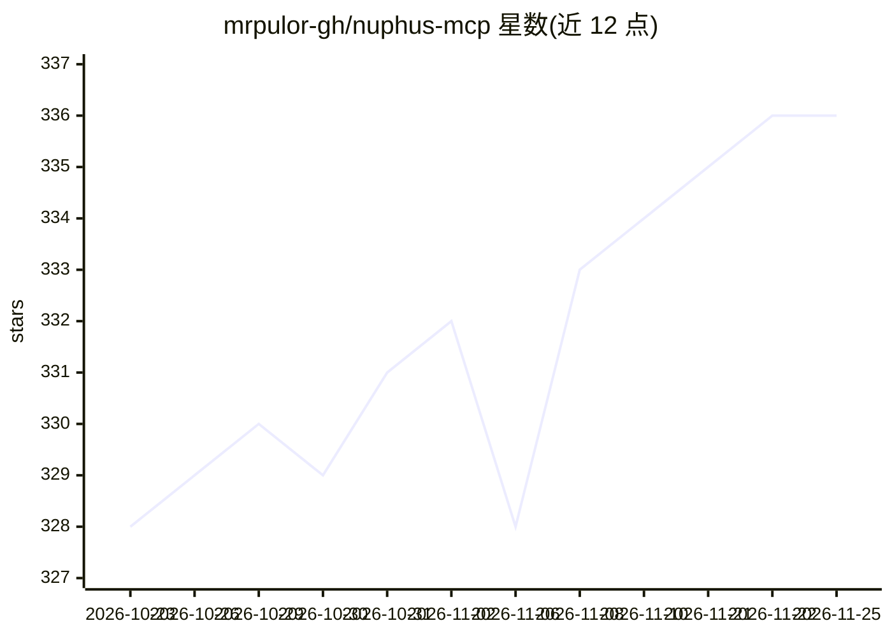

# mrpulor-gh/nuphus-mcp

⭐ 336 · Rust · MIT · 推送 2026-11-12 · [GitHub](https://github.com/mrpulor-gh/nuphus-mcp) · [官网](https://github.com/mrpulor-gh/nuphus-mcp) · 个人维护 · 中文 README

**给 AI agent 提供桌面/浏览器自动化能力的 MCP 服务器**

以 MCP 服务器（stdio JSON-RPC、单二进制）形式将桌面与浏览器自动化暴露为 45 个工具：截图、窗口控制、鼠标键盘、剪贴板，以及基于 Chrome CDP 的浏览器操作（导航、快照、点击、Cookies、标签页、下载等）。支持通过 Windows UIA 与 macOS AX 的语义化 UI 操作流程（observe→pick→execute→verify）。视觉理解通过 BYOK 接入用户自有视觉模型（OpenAI 兼容或 Anthropic 原生协议），OCR（PaddleOCR）与 YOLO 图标检测本地运行。浏览器工具需要 Chrome/Edge；桌面控制对 Windows 支持最完整，macOS 需辅助功能权限，Linux 部分受限。

## 筛选速览

| 维度 | 判定 | 备注 |
|---|---|---|
| AI 角色 | `ai-ecosystem` | LLM/agent 周边工具 |
| 许可风险 | `permissive` | MIT |
| 部署形态 | `desktop` | 安装包/桌面程序 |
| 模型依赖 | local-ok | 支持本地模型 |
| 硬件要求 | — | 无带数字的原话,不猜 |
| 安装摩擦 | `medium` | 含编译或系统依赖之一 |
| 成熟度 | — | 结构信号不足 |

## 能力要点

- 45 个 MCP 工具（22 桌面 + 23 浏览器），stdio 单二进制、无守护进程
- 语义桌面操作：基于 Accessibility/UIA 树，含 verify 状态校验环节
- desktop_vision BYOK 视觉模型 + desktop_perceive 本地 PaddleOCR/YOLO 组合
- 支持外接指纹/反检测浏览器（CDP attach）与调试端口自愈重解析

## 适用场景

- 让 Claude Desktop/Cursor 等 MCP 客户端代为操作桌面窗口与键鼠
- AI agent 自动化浏览器操作（保留登录态、扩展与书签）
- 在无 API key 场景用本地 OCR + 语义定位做桌面自动化
- 驱动指纹浏览器并自动跟随其随机调试端口

## 场景标签

`浏览器自动化` `GUI 自动化` · 领域:效率与自动化

## 证据(README 行号)

> L7: `nuphus-mcp` is a lightweight, cross-platform **desktop automation MCP server**
> L8: that exposes desktop + browser automation as standard MCP tools. It speaks
> L10: Desktop, Cursor, VS Code, Copilot, or any MCP client can connect and

## 星数曲线

2026-10-23 328 → 2026-11-25 336（+8）

---
*卡片 v1 · prompt 1.4 · 生成 2026-11-25 · 置信度 mid · 依据 README sha `bc15dbf3ae79` · [字段定义](../../DATASET.md)*
