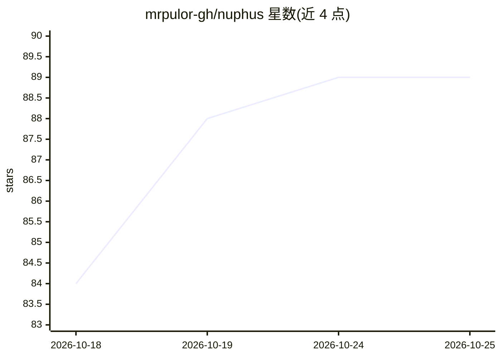

# mrpulor-gh/nuphus

⭐ 89 · Rust · Apache-2.0 · 推送 2026-10-24 · [GitHub](https://github.com/mrpulor-gh/nuphus) · [官网](https://github.com/mrpulor-gh/nuphus) · 个人维护 · 中文 README

**本地优先的桌面 AI Agent：屏幕识别与键鼠自动化+手机遥控**

基于 Tauri v2 + Rust 的桌面 AI Agent 应用，面向个人用户：识别屏幕、操作鼠标键盘与窗口、读写文件、调度内置浏览器，把 LLM 推理转化为桌面自动化；OCR（PP-OCRv4）与语义搜索（Candle）本地运行，对话与记忆存储本机。核心机制包括 Leader 串行决策/并行执行、可并行调度 Cline 与 Claude Code 等外部 Agent、把探索固化为确定性工作流以低 token 重复执行。手机经 PWA 连接同一会话，局域网直连或中继远程。限制：macOS/Linux 上 API Key 暂以明文保存；ChatGPT 套餐接入为官方预览接口。

## 筛选速览

| 维度 | 判定 | 备注 |
|---|---|---|
| AI 角色 | `ai-native` | 本体是模型或模型工具 |
| 许可风险 | `permissive` | Apache-2.0 |
| 部署形态 | `desktop` | 安装包/桌面程序 |
| 模型依赖 | — | README 未给出锁定关系 |
| 硬件要求 | — | 无带数字的原话,不猜 |
| 安装摩擦 | `low` | 无编译、无系统依赖或容器化 |
| 成熟度 | — | 结构信号不足 |

## 能力要点

- 窗口+OCR+键鼠操控任意 GUI，无需对方提供 API
- 工作流编译：LLM 推理一次后低 token 确定性重复执行
- 手机 PWA 与桌面共享同一会话、记忆与执行状态，支持暂停/恢复/轨迹回放
- 内置 23 个 PDF/图像/视频/音频/文档处理命令，本地 PP-OCRv4 与 Candle 引擎

## 适用场景

- 让 AI 代为操作无 API 的桌面软件与网页完成日常任务
- 把反复执行的任务固化为工作流自动运行
- 在手机上远程掌控并回放桌面 Agent 的执行过程
- 本地处理 PDF、图像、音视频文件而不依赖外部工具

## 场景标签

`GUI 自动化` `工作流自动化` `AI 助手` · 领域:效率与自动化

## 证据(README 行号)

> L18: **Nuphus 是运行在你电脑上的 AI Agent——本地、私有、拥有真实的桌面执行力，手机是它的第二块屏幕。**
> L20: 它识别屏幕、操作鼠标键盘、控制窗口、读写文件、调度浏览器，把 LLM 的推理变成真实的自动化。数据留在本机，模型由你选择，Agent 替你做事情。你在桌面发起的每一个会话，手机上都实时同步——同一份记忆、同一个 Agent、同一场
> L66: - **操控任意 GUI** — 窗口 + OCR + 键鼠，任何桌面软件/网页都能自动化，无需对方提供 API

## 星数曲线

2026-10-18 84 → 2026-10-25 89（+5）

---
*卡片 v1 · prompt 1.4 · 生成 2026-10-23 · 置信度 high · 依据 README sha `d5c137381066` · [字段定义](../../DATASET.md)*
