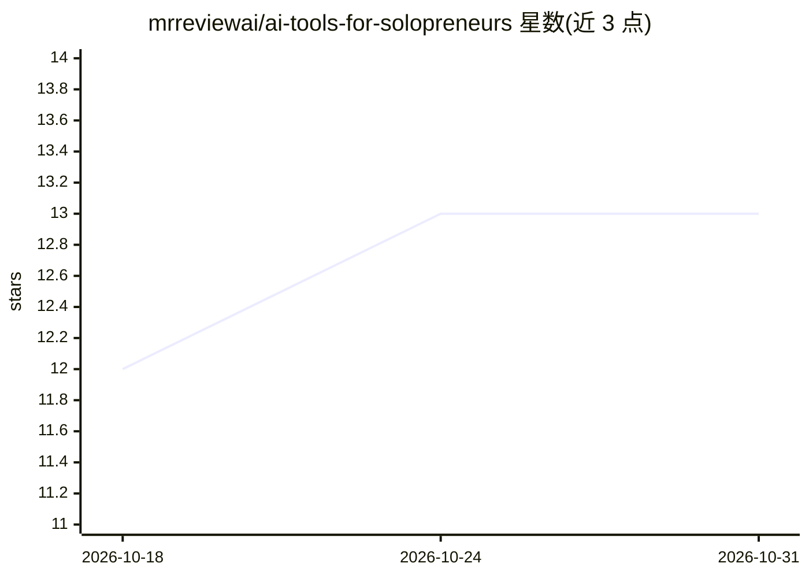

# mrreviewai/ai-tools-for-solopreneurs

⭐ 13 · 推送 2026-06-15 · [GitHub](https://github.com/mrreviewai/ai-tools-for-solopreneurs) · 组织维护

**面向一人企业的 50+ AI 工具策展清单（7 个部门分类）**

由 mrreviewai.com 维护的 AI 工具聚合清单：按开发、设计、文案、营销、客服、财务行政、研究 7 个部门组织 50+ 条 SaaS 工具条目，每条列出功能与价格（免费档/付费），并为每个部门给出 $0 组合方案，末尾汇总 $0 与约 $77/月两套起步工具栈。清单声明收录与评分来自 mrreviewai.com 的 326+ 工具独立评测，免费选项优先排列、无付费排名。条目多为外部商业 SaaS，仓库本身不提供安装或运行方式。

## 筛选速览

| 维度 | 判定 | 备注 |
|---|---|---|
| AI 角色 | `ai-knowledge` | 知识聚合/清单类 |
| 许可风险 | `none` | — |
| 部署形态 | `None` |  |
| 模型依赖 | — | README 未给出锁定关系 |
| 硬件要求 | — | 无带数字的原话,不猜 |
| 安装摩擦 | `low` | 无编译、无系统依赖或容器化 |
| 成熟度 | — | 结构信号不足 |

## 能力要点

- 7 个部门 × 50+ 工具条目，含功能与价格
- 每个部门附 $0 免费工具组合方案
- 提供 $0 与 ~$77/月两套起步工具栈
- 评分来源为 mrreviewai.com 的 326+ 工具独立评测

## 适用场景

- 一人企业按部门查找替代人工的 AI 工具
- 零预算起步时选择免费的工具组合
- 比较不同价位下的工具栈搭配方案

## 场景标签

`精选清单` · 领域:学习与行业

## 证据(README 行号)

> L8: 7 departments · 50+ tools · Built for one-person businesses · Ratings by mrreviewai.com
> L168: All ratings sourced from mrreviewai.com — 326+ AI tools reviewed independently.

## 星数曲线

2026-10-18 12 → 2026-10-31 13（+1）

---
*卡片 v1 · prompt 1.4 · 生成 2026-10-31 · 置信度 high · 依据 README sha `270696efb67d` · [字段定义](../../DATASET.md)*
