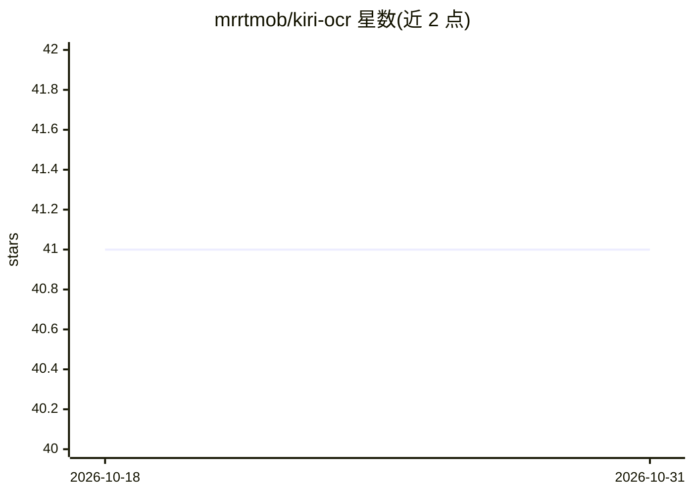

# mrrtmob/kiri-ocr

⭐ 41 · Python · Apache-2.0 · 推送 2026-02-16 · [GitHub](https://github.com/mrrtmob/kiri-ocr) · [官网](https://blizzer.tech) · 个人维护

**面向英语与高棉语文档的轻量 OCR Python 库**

提供文档级文本检测、识别与渲染能力的轻量 OCR 库，基于 Transformer 模型与混合 CTC+注意力解码器，原生支持英语、高棉语及混排文本。自动从 Hugging Face 下载模型，提供 Python API 与 CLI 两种使用方式，支持 fast/accurate 两种解码模式按速度与质量取舍，并可输出逐字符流式识别结果。以 pip 包分发，附 CLI 示例与 Wiki 文档（含训练指南）。基准测试基于 10 种常用字体的合成测试图像。

## 筛选速览

| 维度 | 判定 | 备注 |
|---|---|---|
| AI 角色 | `ai-native` | 本体是模型或模型工具 |
| 许可风险 | `permissive` | Apache-2.0 |
| 部署形态 | `library` | 以包/库形式分发 |
| 模型依赖 | — | README 未给出锁定关系 |
| 硬件要求 | — | 无带数字的原话,不猜 |
| 安装摩擦 | `low` | 无编译、无系统依赖或容器化 |
| 成熟度 | — | 结构信号不足 |

## 能力要点

- Transformer 模型 + 混合 CTC 与注意力解码器
- 英语与高棉语（含混排文本）原生支持
- 自动文本行与词检测的文档处理
- 逐字符流式识别输出与 fast/accurate 解码模式选择

## 适用场景

- 识别英语或高棉语文档中的文字
- 批量处理文档图像并导出识别文本
- 需要流式获取识别进度的实时场景

## 场景标签

`OCR` · 领域:感知与多模态

## 证据(README 行号)

> L10: **Kiri OCR** is a lightweight OCR library for **English and Khmer** documents. It provides document-level text dete
> L18: - **High Accuracy**: Transformer model with hybrid CTC + attention decoder

## 星数曲线

2026-10-18 41 → 2026-10-31 41（+0）

---
*卡片 v1 · prompt 1.4 · 生成 2026-10-25 · 置信度 high · 依据 README sha `d1d86f27fdd6` · [字段定义](../../DATASET.md)*
