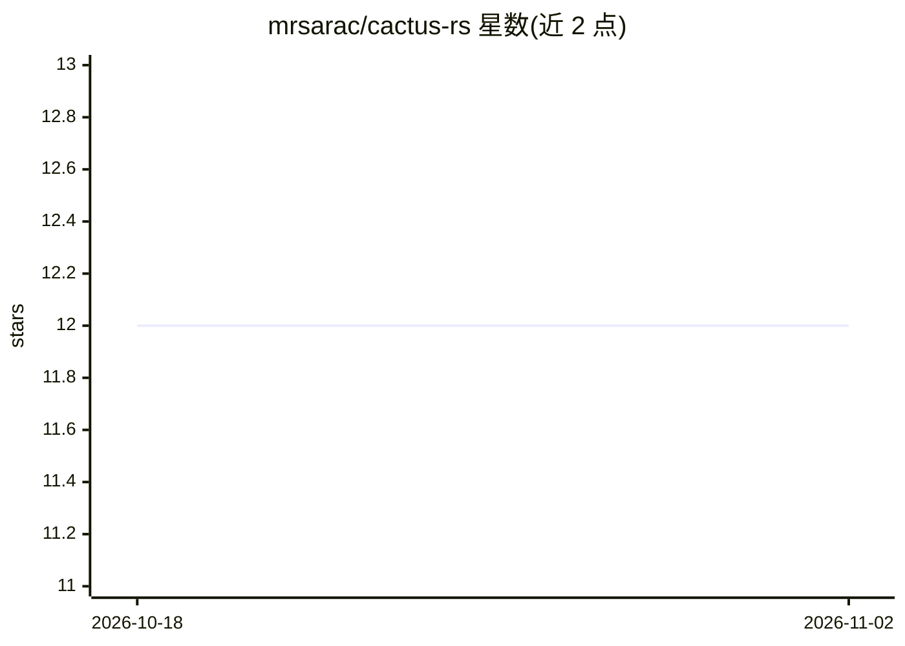

# mrsarac/cactus-rs

⭐ 12 · Rust · MIT · 推送 2026-10-06 · [GitHub](https://github.com/mrsarac/cactus-rs) · 个人维护

**Cactus 端侧推理引擎的非官方 Rust FFI 绑定**

将 C++ 编写的 Cactus 端侧 AI 推理引擎封装为 Rust 库，通过 CMake + bindgen 构建底层 FFI（cactus-sys），上层提供安全 API：LLM 聊天推理（OpenAI 兼容接口）、流式生成、文本/图像/音频嵌入、向量检索、Whisper 兼容语音转写及实时 STT 流式接口。面向需要在 Rust 应用中本地运行模型的开发者。通过 GitHub git 依赖分发（不在 crates.io），需 Rust 1.70+、CMake、Clang 并从源码编译；v0.2.0 需 Cactus v1.5+ 才有完整功能。macOS/Linux 已测试，iOS/Android/Windows 为计划中。

## 筛选速览

| 维度 | 判定 | 备注 |
|---|---|---|
| AI 角色 | `ai-ecosystem` | LLM/agent 周边工具 |
| 许可风险 | `permissive` | MIT |
| 部署形态 | `library` | 以包/库形式分发 |
| 模型依赖 | local-ok | 支持本地模型 |
| 硬件要求 | — | 无带数字的原话,不猜 |
| 安装摩擦 | `medium` | 含编译或系统依赖之一 |
| 成熟度 | — | 结构信号不足 |

## 能力要点

- LLM 本地推理：OpenAI 兼容 chat API 与逐 token 流式回调
- Whisper 兼容语音转写与实时 STT 流式接口（StreamTranscriber）
- 文本/图像/音频嵌入与内置向量检索索引
- Metal (macOS) / Vulkan (Android) GPU 加速，Model 实现Send/Sync

## 适用场景

- 在 Rust 应用中离线运行 LLM 聊天与嵌入推理
- 为桌面或端侧应用集成本地语音转写
- 基于嵌入相似度做本地语义检索

## 场景标签

`推理引擎` · 领域:训练与推理

## 证据(README 行号)

> L3: cactus-rs provides unofficial Rust bindings for the Cactus engine. It is distributed from this git repository rather
> L163: ├── cactus-sys/          # Low-level FFI bindings (unsafe)

## 星数曲线

2026-10-18 12 → 2026-11-02 12（+0）

---
*卡片 v1 · prompt 1.4 · 生成 2026-11-01 · 置信度 high · 依据 README sha `8e6f90949897` · [字段定义](../../DATASET.md)*
