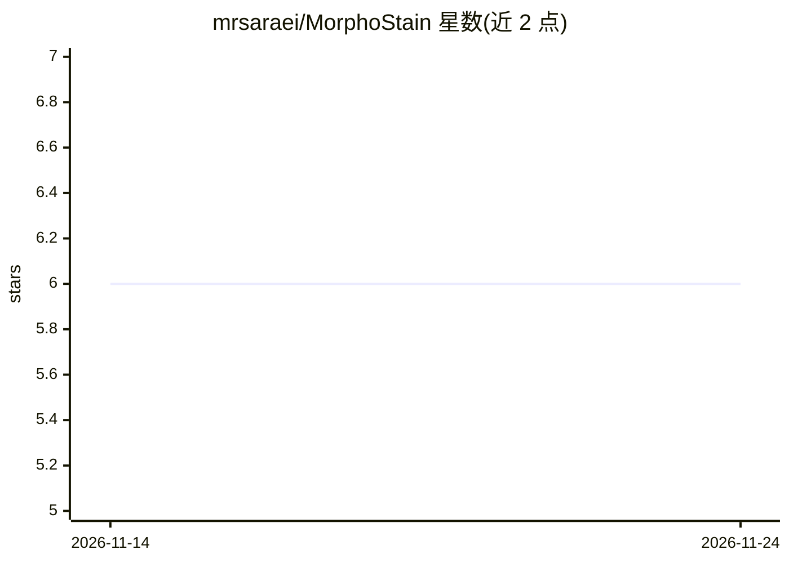

# mrsaraei/MorphoStain

⭐ 6 · Python · 推送 2026-11-18 · [GitHub](https://github.com/mrsaraei/MorphoStain) · [官网](https://doi.org/10.64898/2026.11.15.26368147) · 个人维护

**阿尔茨海默病理切片双染解混的深度学习框架与桌面工具**

面向阿尔茨海默病全切片图像的无监督染色解混框架：利用 Beer–Lambert 光密度投影与 latent diffusion teacher 生成浓度分解，经 Monte Carlo 采样产生不确定性目标，再蒸馏为 0.12M 参数的 FastStudentUNet 用于实时推理。仓库按 Phase 0–9 提供从 SEA-AD 数据下载、切片、训练、基准评测、统计检验到消融的完整脚本，另含 PyQt6 桌面 GUI 支持交互式解混与不确定性可视化。面向神经病理与数字病理研究者。

## 筛选速览

| 维度 | 判定 | 备注 |
|---|---|---|
| AI 角色 | `ai-native` | 本体是模型或模型工具 |
| 许可风险 | `permissive` | — |
| 部署形态 | `library` | 以包/库形式分发 |
| 模型依赖 | — | README 未给出锁定关系 |
| 硬件要求 | — | 无带数字的原话,不猜 |
| 安装摩擦 | `medium` | 含编译或系统依赖之一 |
| 成熟度 | — | 结构信号不足 |

## 能力要点

- 物理引导 latent diffusion teacher 加 0.12M 参数蒸馏学生模型
- Monte Carlo 5 步反向扩散生成像素级不确定性
- PyQt6 桌面 GUI，自动切换 CUDA/MPS/CPU 执行
- 覆盖 SEA-AD 9,908 测试补丁的 8 方法基准与统计检验脚本

## 适用场景

- 分离阿尔茨海默 WSI 中共定位的 Aβ 与 Tau DAB 染色通道
- 复现论文基准、消融与域偏移评测流程
- 在桌面 GUI 中交互检查病理补片的解混与不确定性结果

## 场景标签

`模型评测` `图像视频处理` · 领域:评测与运维

## 证据(README 行号)

> L11: MorphoStain is an unsupervised, physics-guided deep learning framework that resolves the mathematically ill-posed p
> L139:  python MorphoStain.py

## 星数曲线

2026-11-14 6 → 2026-11-24 6（+0）

---
*卡片 v1 · prompt 1.4 · 生成 2026-11-20 · 置信度 high · 依据 README sha `f15eaeec9843` · [字段定义](../../DATASET.md)*
