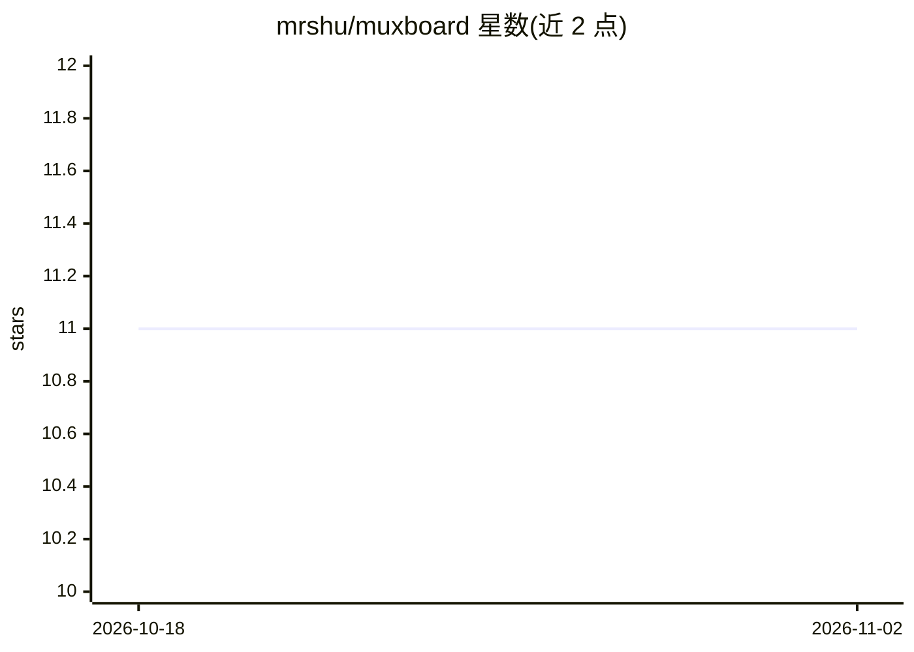

# mrshu/muxboard

⭐ 11 · TypeScript · MIT · 推送 2026-10-13 · [GitHub](https://github.com/mrshu/muxboard) · 个人维护

**在 Stream Deck+ 上集中监控多个 AI 编程 agent 的仪表盘**

macOS 上的 Elgato Stream Deck+ 插件，把 8 个按键变成 cmux 工作区、Orca worktree 和 Herdr 会话（含 SSH 远程机器）中运行编程 agent（Claude Code、Codex、Pi、OMP 等）的共享分诊队列：按键显示状态、时长与来源徽标，按失败/需输入/等待等优先级排序，点按即聚焦对应终端或工作区，长按可本地暂停提醒 5 分钟。LCD 触条通过 CodexBar HTTP 服务自动发现各提供商（Codex、Claude、MiniMax、Kimi、CommandCode、Perplexity）的会话/周配额、重置倒计时、消耗节奏、当日花费与积分。需 macOS、Node.js ≥20、Stream Deck+ 及至少一个 cmux/Orca/Herdr 来源；CodexBar 可选。

## 筛选速览

| 维度 | 判定 | 备注 |
|---|---|---|
| AI 角色 | `ai-ecosystem` | LLM/agent 周边工具 |
| 许可风险 | `permissive` | MIT |
| 部署形态 | `library` | 以包/库形式分发 |
| 模型依赖 | — | README 未给出锁定关系 |
| 硬件要求 | — | 无带数字的原话,不猜 |
| 安装摩擦 | `low` | 无编译、无系统依赖或容器化 |
| 成熟度 | — | 结构信号不足 |

## 能力要点

- 8 按键分诊队列聚合 cmux/Orca/Herdr 三种来源的 agent 状态
- LCD 自动发现 CodexBar 各提供商的配额、重置、节奏与花费
- 点按聚焦已有终端/工作区，长按本地静音提醒 5 分钟
- Orca 与 Herdr 自动发现，来源断连时保留最后有效数据

## 适用场景

- 同时跑多个 AI 编程 agent 时在硬件按键上一眼分诊谁需要我
- 在 LCD 上实时查看各 LLM 提供商的配额与当日花费
- 跨 cmux 工作区与 Herdr SSH 远程会话统一管理编程 agent

## 场景标签

 · 领域:开发者工具/AI agent 监控

## 证据(README 行号)

> L17: Muxboard turns the 8 keys of an Elgato Stream Deck+ into a shared queue of
> L25: Herdr support). The LCD touch strip shows usage for every
> L63: |LCD touch strip|Quotas, resets, pace, spend, tokens, and credits|CodexBar|

## 星数曲线

2026-10-18 11 → 2026-11-02 11（+0）

---
*卡片 v1 · prompt 1.4 · 生成 2026-11-02 · 置信度 mid · 依据 README sha `de8dd4027206` · [字段定义](../../DATASET.md)*
