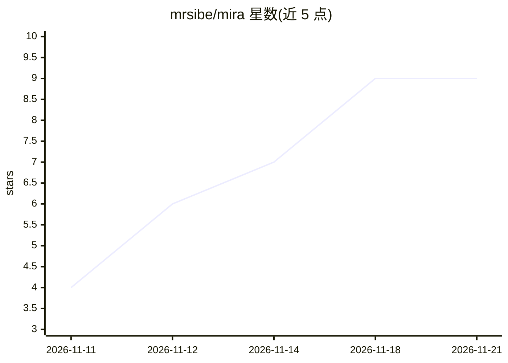

# mrsibe/mira

⭐ 9 · TypeScript · MIT · 推送 2026-11-20 · [GitHub](https://github.com/mrsibe/mira) · 个人维护 · 中文 README

**本地优先的桌面端 LLM 对话客户端，自带 API Key 接入多家模型**

以 MIT 许可发布的跨平台桌面应用（Go + WebView，需 Bun 构建），面向希望自管密钥与本机数据的用户：接入 OpenAI、Anthropic、Gemini、DeepSeek 等服务商或本地 Ollama，对话以 JSONL 保存在本机，密钥存入系统钥匙串。提供流式输出、token 统计、BM25 历史检索、自动长期记忆摘要、联网搜索（DuckDuckGo 默认）与交互式组件渲染。无云同步，迁移需手动复制数据目录。

## 筛选速览

| 维度 | 判定 | 备注 |
|---|---|---|
| AI 角色 | `ai-native` | 本体是模型或模型工具 |
| 许可风险 | `permissive` | MIT |
| 部署形态 | `desktop` | 安装包/桌面程序 |
| 模型依赖 | local-ok | 支持本地模型 |
| 硬件要求 | — | 无带数字的原话,不猜 |
| 安装摩擦 | `low` | 无编译、无系统依赖或容器化 |
| 成熟度 | — | 结构信号不足 |

## 能力要点

- 接入 OpenAI/Anthropic/Gemini/DeepSeek/OpenRouter/xAI 及任意 OpenAI 兼容端点，支持本地 Ollama/LM Studio
- 对话、项目与长期记忆保存在本机，密钥存入系统钥匙串
- BM25 历史检索与每 8 条消息自动整理的记忆摘要，可查看编辑
- 回答支持表格、图表、表单等内置组件，展示思考过程与 token 用量

## 适用场景

- 用已有 API Key 在桌面端统一使用多家模型服务
- 对话历史与记忆留在本机的隐私场景
- 配合本地 Ollama 零 API 成本对话

## 场景标签

`聊天机器人` `AI 助手` · 领域:对话与助手

## 证据(README 行号)

> L5:  本地优先的 ChatGPT 桌面客户端
> L17: Mira 把 ChatGPT 式的对话体验带进 Windows、macOS 和 Linux 桌面，模型由你选择：
> L18: 接入 OpenAI、Anthropic、Gemini、DeepSeek，或在本机运行 Ollama。对话、项目、

## 星数曲线

2026-11-11 4 → 2026-11-21 9（+5）

---
*卡片 v1 · prompt 1.4 · 生成 2026-11-20 · 置信度 high · 依据 README sha `aa7cbd1dfdda` · [字段定义](../../DATASET.md)*
