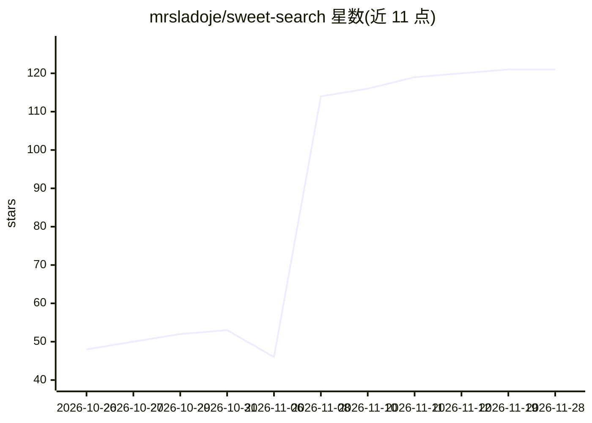

# mrsladoje/sweet-search

⭐ 121 · JavaScript · Apache-2.0 · 推送 2026-11-11 · [GitHub](https://github.com/mrsladoje/sweet-search) · [官网](https://www.npmjs.com/package/sweet-search) · 个人维护

**为 Claude Code/Codex 等编码 agent 提供本地代码搜索的 CLI**

sweet-search 是一组面向 AI 编码 agent 的本地代码搜索工具（npm CLI + 可选 MCP 服务器），提供 search、grep、find、semantic、trace、read 六个工具，以及 PageRank 排序的 repo-map。索引用 candle 与 cAST 分块构建，daemon 随工作树增量更新。init 会向 Claude Code、Codex、opencode 写入 agent 配置与系统提示词，也可生成 AGENTS.md/GEMINI.md/Cursor 规则。模型在本机运行，无 API key、无云服务；支持约 50 种编程语言及配置/构建/文档文件。要求 Node.js 22+，原生 Windows 暂不支持，需用 WSL2。

## 筛选速览

| 维度 | 判定 | 备注 |
|---|---|---|
| AI 角色 | `ai-ecosystem` | LLM/agent 周边工具 |
| 许可风险 | `permissive` | Apache-2.0 |
| 部署形态 | `self-host` | docker 或自建部署 |
| 模型依赖 | — | README 未给出锁定关系 |
| 硬件要求 | `cpu-ok` | |
| 安装摩擦 | `low` | 无编译、无系统依赖或容器化 |
| 成熟度 | — | 结构信号不足 |

## 能力要点

- 六个搜索工具外加 8 工具 MCP 服务器（read-only、idempotent）
- 一次索引后由 daemon 随编辑自动增量更新，含未提交改动
- 100% 本地运行：无 API key、无云、无 Docker
- init 按所选 agent（Claude Code/Codex/opencode 等）写入对应配置与提示词

## 适用场景

- 让 Claude Code/Codex 会话用本地索引替代逐次 grep+Read 检索
- 在 MCP 客户端中注册只读代码搜索工具集
- 为子 agent 生成符合 token 预算的仓库符号概览

## 场景标签

`语义搜索` · 领域:知识与检索

## 证据(README 行号)

> L5: Six fast, purpose-built tools made for *Claude Code*, *Codex* & friends 👀
> L100: - **Footprint** — models live in `~/.cache/sweet-search/models/` and run on-device only:
> L194:  💻&nbsp;Platforms ✅ First-class: macOS (Apple Silicon, Intel) · Linux x64/arm64 (glibc) · Windows via WSL2 ☑️ Supp

## 星数曲线

2026-10-26 48 → 2026-11-28 121（+73）

---
*卡片 v1 · prompt 1.4 · 生成 2026-11-28 · 置信度 mid · 依据 README sha `418c27dd4301` · [字段定义](../../DATASET.md)*
