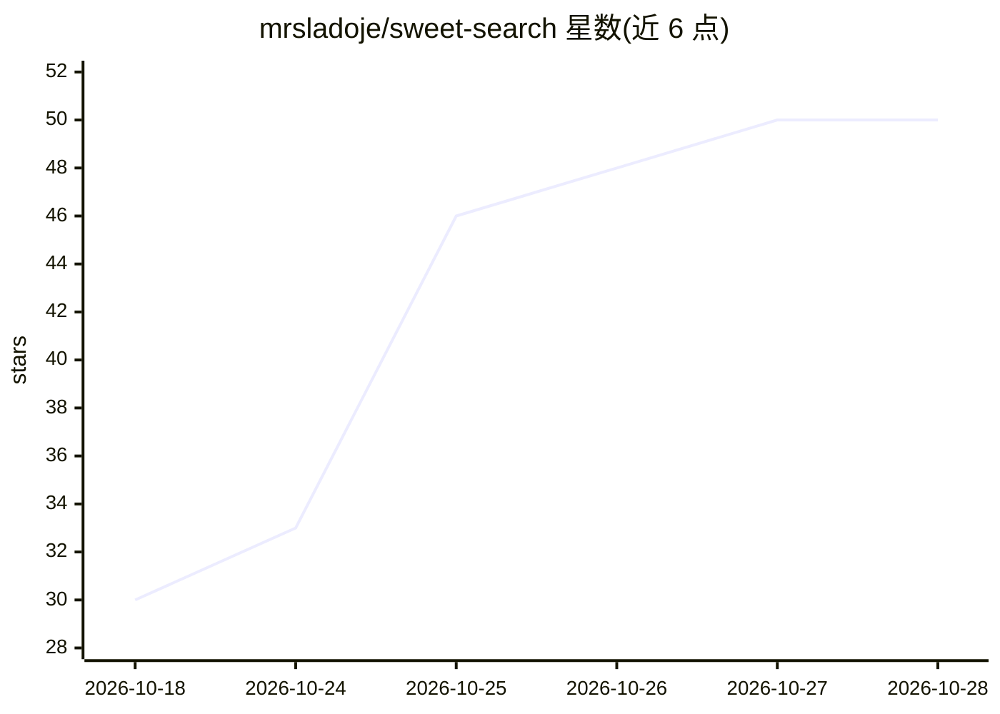

# mrsladoje/sweet-search

⭐ 50 · JavaScript · Apache-2.0 · 推送 2026-10-24 · [GitHub](https://github.com/mrsladoje/sweet-search) · [官网](https://www.npmjs.com/package/sweet-search) · 个人维护

**面向 AI 编程代理的本地代码搜索工具集（六工具+索引）**

为 Claude Code、Codex、opencode 等 AI 编程代理提供的本地代码搜索方案：以 npm 安装 CLI，一条命令建立 GPU 加速索引，索引随编辑增量自更新；提供 search、grep、find、semantic、trace、read 六个工具及 MCP 服务器（8 工具）。嵌入推理在设备端运行，支持 Metal/CUDA/CoreML。基准基于 200 个工程任务，声称降低代理运行成本与模型时间；不推荐 8 GB RAM 以下弱机型。原生 Windows 暂不支持，需 WSL2。

## 筛选速览

| 维度 | 判定 | 备注 |
|---|---|---|
| AI 角色 | `ai-ecosystem` | LLM/agent 周边工具 |
| 许可风险 | `permissive` | Apache-2.0 |
| 部署形态 | `self-host` | docker 或自建部署 |
| 模型依赖 | locked-api |  |
| 硬件要求 | — | 无带数字的原话,不猜 |
| 安装摩擦 | `low` | 无编译、无系统依赖或容器化 |
| 成熟度 | — | 结构信号不足 |

## 能力要点

- 六个面向代理的工具：search/grep/find/semantic/trace/read
- 一次索引、增量自更新（含未提交修改）
- 100% 本地运行，无 API key、无云依赖
- Rust 引擎预编译发布，支持 Metal/CUDA/CoreML 推理

## 适用场景

- 让 Claude Code/Codex 等 AI 代理以更低成本检索代码库
- 在本地为代理提供语义+正则混合搜索与 repo map
- 通过 MCP 客户端接入代码检索能力

## 场景标签

`语义搜索` · 领域:知识与检索

## 证据(README 行号)

> L1: sweet-search — local code search for AI coding agents
> L5: Six fast, purpose-built tools made for *Claude Code*, *Codex* & friends 👀
> L136: - **MCP server:** 8 tools (`search`, `trace`, `read`, `read-semantic`, `index`, `health`, `repo-map`, `vocab-prewa

## 星数曲线

2026-10-18 30 → 2026-10-28 50（+20）

---
*卡片 v1 · prompt 1.4 · 生成 2026-10-25 · 置信度 mid · 依据 README sha `897c6af376a2` · [字段定义](../../DATASET.md)*
