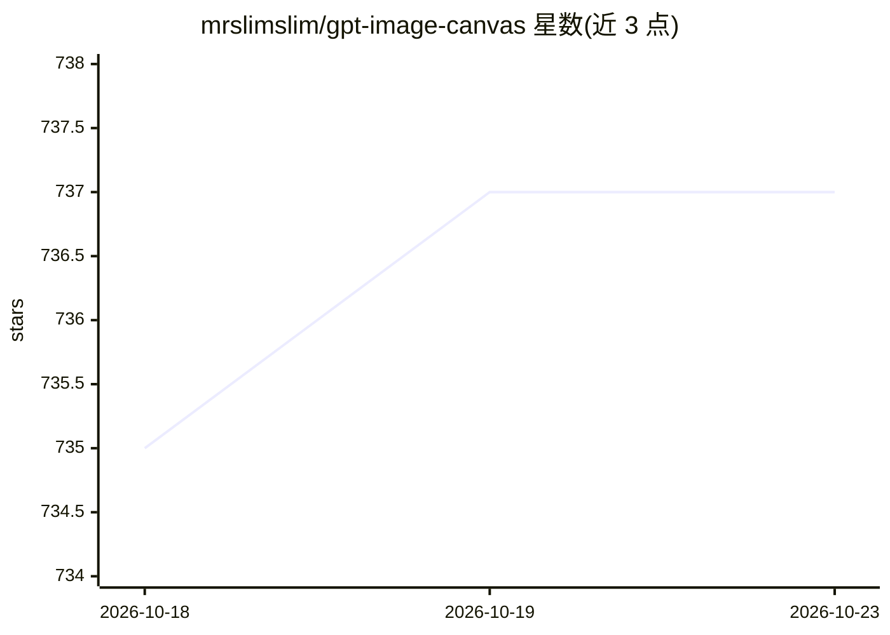

# mrslimslim/gpt-image-canvas

⭐ 737 · TypeScript · MIT · 推送 2026-08-27 · [GitHub](https://github.com/mrslimslim/gpt-image-canvas) · [官网](https://github.com/mrslimslim/gpt-image-canvas) · 个人维护 · 中文 README

**本地优先的 AI 图像画布：tldraw 画布上提示词生图与 Agent 规划**

基于 tldraw、Hono、SQLite 与 GPT Image 2 构建的本地图像创作工作台：在画布上通过文本提示词生成图像，或将选中画布图像作为参考图生成；Agent 标签页可规划多图任务并按 DAG 执行，单个计划上限 16 张图。支持 .env、应用内配置或 Codex 登录三种接入 OpenAI 兼容图像端点的方式，生成资产与历史保存在本地 SQLite，可选用腾讯云 COS 或 Cloudflare R2/S3 备份。提供 pnpm 源码运行与 Docker Compose/GHCR 镜像两种部署方式，面向本地工作站使用。

## 筛选速览

| 维度 | 判定 | 备注 |
|---|---|---|
| AI 角色 | `ai-native` | 本体是模型或模型工具 |
| 许可风险 | `permissive` | MIT |
| 部署形态 | `self-host` | docker 或自建部署 |
| 模型依赖 | — | README 未给出锁定关系 |
| 硬件要求 | — | 无带数字的原话,不猜 |
| 安装摩擦 | `low` | 无编译、无系统依赖或容器化 |
| 成熟度 | — | 结构信号不足 |

## 能力要点

- tldraw 画布上的提示词生图与参考图生图
- Agent 规划多图任务并按 DAG 依赖并行执行（单计划上限 16 图）
- 三种 provider 接入方式：.env / 应用内配置 / Codex OAuth 登录
- 生成资产本地保存，可选备份到腾讯云 COS 或 Cloudflare R2/S3

## 适用场景

- 在可视化画布上迭代生成和编排 AI 图像
- 让 Agent 规划并批量执行多图生成任务
- 本地保存生成历史与资产并可选云备份

## 场景标签

`图像生成` · 领域:内容生成

## 证据(README 行号)

> L5: Local AI image canvas for prompt-to-image generation, reference-image generation, and multi-step Agent planning. It 
> L13: - Create and arrange AI-generated images on a tldraw canvas.
> L14: - Generate from text prompts or use selected canvas images as references.

## 星数曲线

2026-10-18 735 → 2026-10-23 737（+2）

---
*卡片 v1 · prompt 1.4 · 生成 2026-10-21 · 置信度 high · 依据 README sha `ee6af9c3a376` · [字段定义](../../DATASET.md)*
