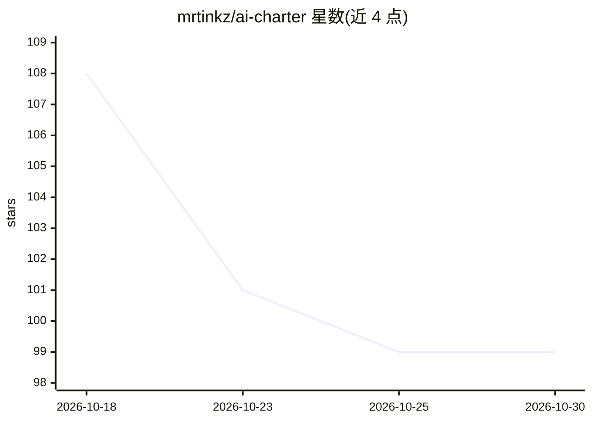

# mrtinkz/ai-charter

⭐ 99 · TypeScript · MIT · 推送 2026-09-26 · [GitHub](https://github.com/mrtinkz/ai-charter) · [官网](https://mrtinkz.github.io/ai-charter/) · 个人维护

**通用 AI 宪章与模型认证登记公开站点**

发布 Universal AI Charter 的公开网站：宪章以披露而非放缓为核心原则，分为 Access & Equity、Governance & Disclosure 等六组条款。提供认证流程——公司通过表单填写训练来源、风险类别、代理决策、意外后果等生成认证 JSON，经 PR 合入仓库后进入可搜索的认证登记表。另含按严重度色彩编码的 hazard placard 类别、博客与 FAQ。基于 React/TypeScript/Vite 构建，通过 PR 贡献认证与新增类别。

## 筛选速览

| 维度 | 判定 | 备注 |
|---|---|---|
| AI 角色 | `ai-knowledge` | 知识聚合/清单类 |
| 许可风险 | `permissive` | MIT |
| 部署形态 | `library` | 以包/库形式分发 |
| 模型依赖 | — | README 未给出锁定关系 |
| 硬件要求 | — | 无带数字的原话,不猜 |
| 安装摩擦 | `low` | 无编译、无系统依赖或容器化 |
| 成熟度 | — | 结构信号不足 |

## 能力要点

- 六组条款的通用 AI 治理宪章（活文档，随治理需求修订）
- 表单生成模型认证 JSON 并经 PR 合入可搜索登记表
- 按严重度色彩编码、开放新增的 hazard placard 类别体系

## 适用场景

- 为公司模型生成并提交宪章认证
- 查阅已认证模型的训练来源与风险披露
- 了解基于披露原则的 AI 治理主张

## 场景标签

 · 领域:AI 治理/认证

## 证据(README 行号)

> L5: A public site for the Universal AI Charter: a governance charter built on disclosure instead of a development
> L16: - **Certify** (`/certify`) — a form for companies to generate a certification file for a model (company, version,

## 星数曲线

2026-10-18 108 → 2026-10-30 99（-9）

---
*卡片 v1 · prompt 1.4 · 生成 2026-10-23 · 置信度 high · 依据 README sha `fe17bdaf7055` · [字段定义](../../DATASET.md)*
