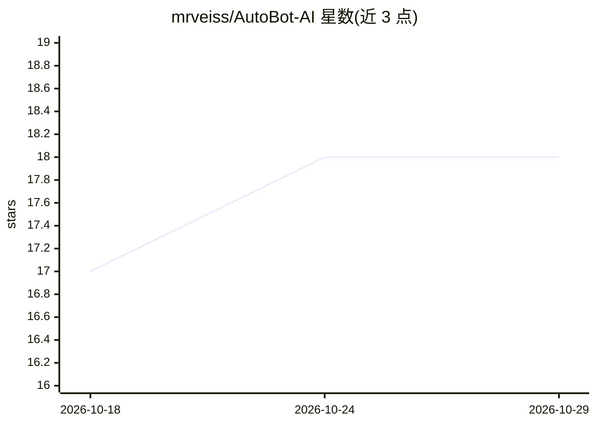

# mrveiss/AutoBot-AI

⭐ 18 · Python · Apache-2.0 · 推送 2026-10-28 · [GitHub](https://github.com/mrveiss/AutoBot-AI) · [官网](https://mrveiss.github.io/AutoBot-AI/) · 个人维护

**自托管私有 AI 平台：聊天、RAG 知识库与 Agent 模块，数据留在自有硬件**

Apache-2.0 的自托管 AI 平台，分三层：平台核心（多轮聊天、RAG 知识库、知识图谱记忆、带 provider 回退的 LLM 网关、本地推理、治理/RBAC/审计）、服务生命周期管理器 SLM（用 Ansible 部署/运维/扩容向量库、数据库、推理等全栈，支持多机 fleet）、可安装模块（Company OS 自治 agent 公司、代码库分析、本地转录 Transcriber）。安装提供 Ubuntu 一行脚本或 Docker Compose（捆绑 Ollama 容器，可改配 Anthropic 等托管 provider）。面向需要在自有基础设施上运行私有 AI 的用户；README 明确声明不主张任何合规认证。

## 筛选速览

| 维度 | 判定 | 备注 |
|---|---|---|
| AI 角色 | `ai-native` | 本体是模型或模型工具 |
| 许可风险 | `permissive` | Apache-2.0 |
| 部署形态 | `desktop` | 安装包/桌面程序 |
| 模型依赖 | local-ok | 支持本地模型 |
| 硬件要求 | — | 无带数字的原话,不猜 |
| 安装摩擦 | `low` | 无编译、无系统依赖或容器化 |
| 成熟度 | — | 结构信号不足 |

## 能力要点

- 平台核心：聊天流式输出、RAG 知识库、知识图谱记忆、provider 无关的 LLM 网关
- SLM 管理层负责向量库/数据库/推理/worker 的部署、运维与跨机扩容
- 模块体系：Company OS（自治 agent 公司）、代码库分析、本地音频转录
- 治理能力：RBAC、审计日志、MFA、密钥库、human-in-the-loop 审批

## 适用场景

- 在我自己的服务器上搭建不外泄数据的私有 AI 聊天与知识库
- 用自然语言和可视化工作流管理 AI、基础设施与分析任务
- 让一组 AI agent 按目标与待办自主工作并管控其开销
- 本地转写录音、分析代码库风险而不让源码离开本机

## 场景标签

`多智能体` `工作流自动化` `RAG` `语音识别` · 领域:Agent 开发

## 证据(README 行号)

> L115: AutoBot is a **self-hosted AI platform**: conversational AI, a private knowledge base,
> L44: 1. **Platform Core** — small, solid, and yours. Chat and streaming, a RAG knowledge
> L79: language model, and every model tier points at the bundled Ollama container, which only

## 星数曲线

2026-10-18 17 → 2026-10-29 18（+1）

---
*卡片 v1 · prompt 1.4 · 生成 2026-10-29 · 置信度 high · 依据 README sha `9237eca7049b` · [字段定义](../../DATASET.md)*
