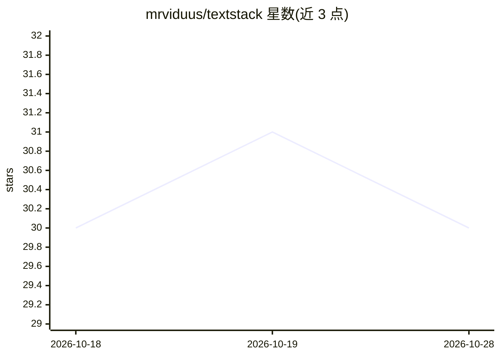

# mrviduus/textstack

⭐ 30 · TypeScript · AGPL-3.0 · 推送 2026-10-27 · [GitHub](https://github.com/mrviduus/textstack) · [官网](https://textstack.app/) · 个人维护

**可接入自有 AI 助手的技术书阅读器（EPUB/PDF/FB2）**

面向读者的电子书阅读应用，支持浏览目录或上传自有 EPUB/PDF，阅读器提供主题、书签、高亮、朗读、阅读统计与跨设备进度同步，Web/Android 可离线阅读。AI 功能包括：选词获取结合上下文的短释义或翻译、查词以间隔重复方式复习、以及作为 MCP 服务器让用户已在用的 AI 助手（Claude、ChatGPT、Cursor）检索图书馆、讨论章节并将结论写回书中。技术栈为 ASP.NET Core + React + Expo，可通过 Docker 与 pnpm 自托管。

## 筛选速览

| 维度 | 判定 | 备注 |
|---|---|---|
| AI 角色 | `ai-enhanced` | 去掉 AI 部分产品仍成立 |
| 许可风险 | `viral` | AGPL-3.0 |
| 部署形态 | `library` | 以包/库形式分发 |
| 模型依赖 | — | README 未给出锁定关系 |
| 硬件要求 | — | 无带数字的原话,不猜 |
| 安装摩擦 | `low` | 无编译、无系统依赖或容器化 |
| 成熟度 | — | 结构信号不足 |

## 能力要点

- 选词获取结合书籍上下文的释义与翻译
- 查词保存原句并按间隔重复复习
- MCP 服务器：外部 AI 助手可检索图书馆、讨论章节并将结论写回书（需用户确认）
- Web 与 Android 均支持离线阅读与进度同步

## 适用场景

- 阅读艰深技术书时即查不懂的词句并复习
- 用自己的 AI 助手讨论当前章节并保存笔记回书中
- 自托管一个可离线使用的电子书阅读服务

## 场景标签

 · 领域:阅读/学习工具

## 证据(README 行号)

> L22: |**Kindle-like reader**|Themes, fonts, fullscreen, keyboard shortcuts, bookmarks, highlights, reading stats.|
> L27: |**AI assistant (MCP)**|Connect your own AI assistant to your library. See below.|
> L31: TextStack is a Model Context Protocol server, so an assistant you already use (Claude, ChatGPT, Cursor) can work wi

## 星数曲线

2026-10-18 30 → 2026-10-28 30（+0）

---
*卡片 v1 · prompt 1.4 · 生成 2026-10-26 · 置信度 mid · 依据 README sha `4957d9f4851d` · [字段定义](../../DATASET.md)*
