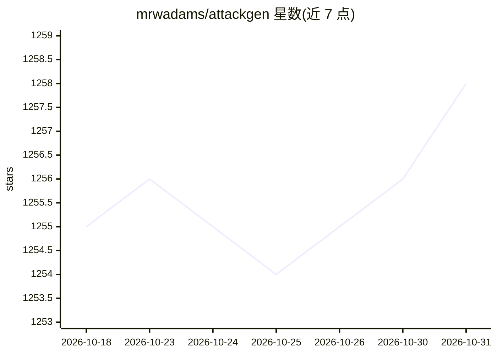

# mrwadams/attackgen

⭐ 1,258 · Python · GPL-3.0 · 推送 2026-10-24 · [GitHub](https://github.com/mrwadams/attackgen) · 个人维护

**用 LLM 生成网络安全事件响应演练场景的工具**

面向安全团队的桌面推演（tabletop exercise）生成工具：基于 MITRE ATT&CK Enterprise/ICS 与 ATLAS 框架，结合用户选择的威胁 Actor 组、AI 攻击案例或自定义技术清单，生成定制化事件响应场景，含成功标准、指标、artefact 与演练规则等章节，可下载 Markdown。支持 AI Insider Threat 场景与场景修订 Assistant 聊天界面。模型接入经 LiteLLM 统一路由，支持 OpenAI/Anthropic/Google/Mistral/Groq 及 Ollama、LM Studio、Azure OpenAI、OpenRouter 等 OpenAI 兼容端点。提供 Docker 镜像与 PyPI 安装；要求 Python 3.11 以上。

## 筛选速览

| 维度 | 判定 | 备注 |
|---|---|---|
| AI 角色 | `ai-native` | 本体是模型或模型工具 |
| 许可风险 | `viral` | GPL-3.0 |
| 部署形态 | `self-host` | docker 或自建部署 |
| 模型依赖 | local-ok | 支持本地模型 |
| 硬件要求 | — | 无带数字的原话,不猜 |
| 安装摩擦 | `low` | 无编译、无系统依赖或容器化 |
| 成熟度 | — | 结构信号不足 |

## 能力要点

- 基于威胁 Actor 组或 ATLAS 案例生成定制事件响应场景
- 支持 ATT&CK Enterprise/ICS 与 ATLAS 框架，含 AI Insider Threat 场景
- 模型接入统一经 LiteLLM 路由，支持多家 API 与 OpenAI 兼容端点
- 场景可下载为 Markdown，含 ATT&CK Navigator 层与 Detection & Response 报告

## 适用场景

- 安全团队按威胁 Actor 定制事件响应桌面推演
- 针对 AI/ML 系统攻击（ATLAS）开展演练
- 紫队演练叙事与检测响应报告生成

## 场景标签

`网络安全` · 领域:学习与行业

## 证据(README 行号)

> L3: AttackGen is a cybersecurity incident response testing tool that leverages the power of large language models and th
> L25: - Use the OpenAI API, Anthropic API (Claude models), Google AI API, Mistral API, Groq API, or any custom OpenAI-com

## 星数曲线

2026-10-18 1,255 → 2026-10-31 1,258（+3）

---
*卡片 v1 · prompt 1.4 · 生成 2026-10-21 · 置信度 high · 依据 README sha `ee0aa77a0e6f` · [字段定义](../../DATASET.md)*
