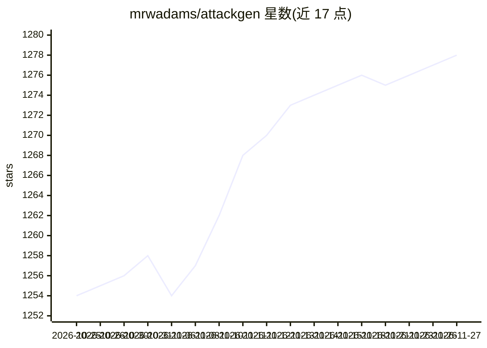

# mrwadams/attackgen

⭐ 1,278 · Python · GPL-3.0 · 推送 2026-11-26 · [GitHub](https://github.com/mrwadams/attackgen) · 个人维护

**基于 LLM 与 MITRE ATT&CK 生成事件响应演练场景的安全测试工具**

面向安全团队的的事件响应测试工具：按用户选择的威胁组织或 ATLAS 案例，结合组织规模与行业信息，通过大语言模型生成定制化事件响应场景，输出 Markdown 下载件、检测与响应报告及 ATT&CK Navigator 层。支持 ATT&CK Enterprise/ICS/ATLAS 三套框架、自定义技术组合、AI 内部威胁场景模板，并提供聊天助手修改场景、MCP server 与 agent skill 供 agentic 客户端调用。模型调用统一经 LiteLLM 路由；需用户自备各模型提供商的 API key，场景生成质量依赖所选模型。

## 筛选速览

| 维度 | 判定 | 备注 |
|---|---|---|
| AI 角色 | `ai-native` | 本体是模型或模型工具 |
| 许可风险 | `viral` | GPL-3.0 |
| 部署形态 | `self-host` | docker 或自建部署 |
| 模型依赖 | local-ok | 支持本地模型 |
| 硬件要求 | — | 无带数字的原话,不猜 |
| 安装摩擦 | `low` | 无编译、无系统依赖或容器化 |
| 成熟度 | — | 结构信号不足 |

## 能力要点

- 按威胁组织、ATLAS 案例或自定义 ATT&CK 技术组合生成事件响应场景
- 支持 ATT&CK Enterprise/ICS/ATLAS 框架及 AI 增强对手、紫队叙事开关
- 生成检测策略、分析、日志源与缓解措施的配套报告及 Navigator layer 下载
- MCP server 与 attackgen-tabletop Agent Skill 供 agentic 客户端调用

## 适用场景

- 为紫队桌面推演快速生成针对特定威胁组织的事件响应场景
- 按本组织规模与行业定制事件响应演练脚本
- 为场景中的技术生成检测策略与缓解措施清单
- 通过 MCP 在 agent 客户端中生成与查询演练场景

## 场景标签

`网络安全` · 领域:学习与行业

## 证据(README 行号)

> L3: AttackGen is a cybersecurity incident response testing tool that leverages the power of large language models and th
> L29: - Use the OpenAI API, Anthropic API (Claude models), Google AI API, Mistral API, Groq API, or any custom OpenAI-com
> L30: - Available as a Docker container image for easy deployment.

## 星数曲线

2026-10-25 1,254 → 2026-11-27 1,278（+24）

---
*卡片 v1 · prompt 1.4 · 生成 2026-11-23 · 置信度 high · 依据 README sha `d18381e579e3` · [字段定义](../../DATASET.md)*
