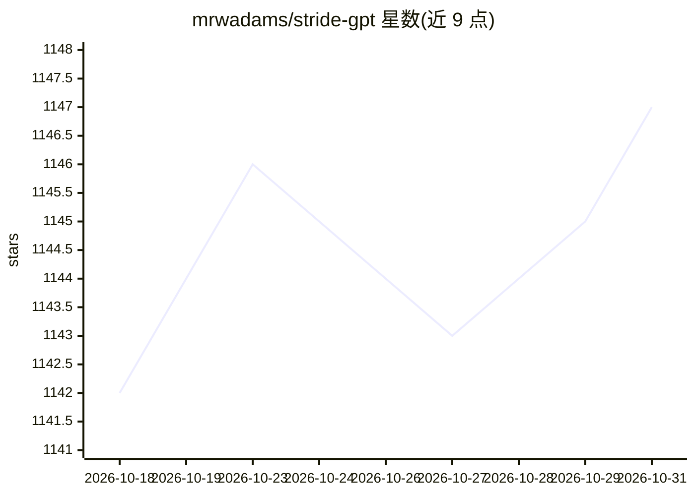

# mrwadams/stride-gpt

⭐ 1,147 · Python · MIT · 推送 2026-10-29 · [GitHub](https://github.com/mrwadams/stride-gpt) · [官网](https://stridegpt.streamlit.app) · 个人维护

**用 LLM 按 STRIDE 方法生成威胁模型与攻击树的工具**

面向应用安全人员的 AI 威胁建模工具：用户输入应用类型、认证方式、是否面向互联网、是否处理敏感数据等描述，或直接指向代码库/GitHub 仓库，由 LLM 生成 STRIDE 威胁模型、攻击树、DREAD 风险评分、缓解建议、Gherkin 测试用例与数据流图（DFD）。支持 CLI、REPL 与 Streamlit 界面，经 LiteLLM 接入 OpenAI、Anthropic、Google、Mistral、Groq、DeepSeek、OpenRouter 及 LM Studio 本地服务。输出 Markdown/JSON/SARIF/HTML，提供 Docker 镜像；声明不存储应用数据。

## 筛选速览

| 维度 | 判定 | 备注 |
|---|---|---|
| AI 角色 | `ai-native` | 本体是模型或模型工具 |
| 许可风险 | `permissive` | MIT |
| 部署形态 | `self-host` | docker 或自建部署 |
| 模型依赖 | locked-api |  |
| 硬件要求 | — | 无带数字的原话,不猜 |
| 安装摩擦 | `low` | 无编译、无系统依赖或容器化 |
| 成熟度 | — | 结构信号不足 |

## 能力要点

- 生成 STRIDE 威胁模型、攻击树、DREAD 评分与 Gherkin 测试用例
- CLI 自主代理式代码库分析：规划子系统、逐个探索并汇总发现
- MITRE ATT&CK/ATLAS 技术标注，输出 SARIF 可导入 GitHub/GitLab/IDE
- OWASP LLM Top 10 与 Agentic AI（ASI）专项威胁建模

## 适用场景

- 为新应用快速产出 STRIDE 威胁模型与缓解建议
- 对代码库做自动化的深度威胁分析并生成报告
- 对 GenAI 或 agentic 系统做专项安全威胁建模

## 场景标签

`网络安全` · 领域:学习与行业

## 证据(README 行号)

> L3: STRIDE GPT is an AI-powered threat modelling tool that leverages Large Language Models (LLMs) to generate threat mod
> L22: - Generates threat models based on the STRIDE methodology

## 星数曲线

2026-10-18 1,142 → 2026-10-31 1,147（+5）

---
*卡片 v1 · prompt 1.4 · 生成 2026-10-21 · 置信度 high · 依据 README sha `d3c85c0def6b` · [字段定义](../../DATASET.md)*
