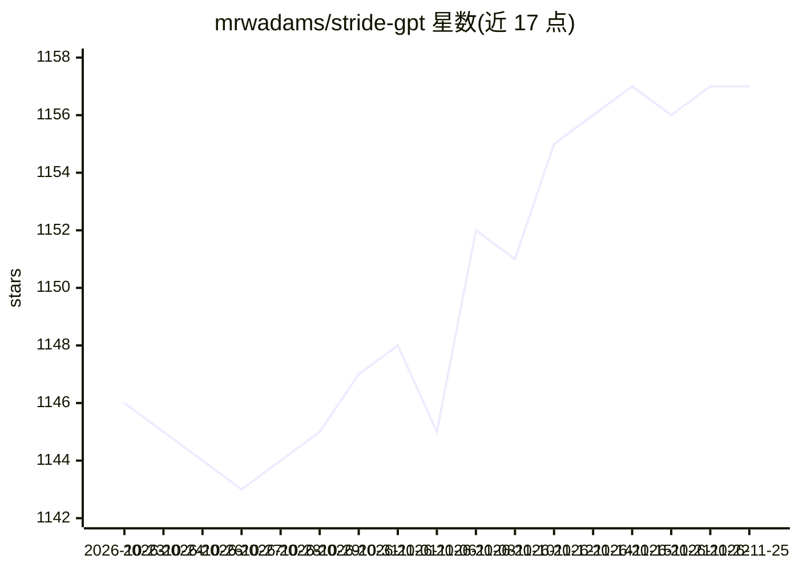

# mrwadams/stride-gpt

⭐ 1,157 · Python · MIT · 推送 2026-11-19 · [GitHub](https://github.com/mrwadams/stride-gpt) · [官网](https://stridegpt.streamlit.app) · 个人维护

**基于 LLM 生成 STRIDE 威胁模型与攻击树的安全工具**

STRIDE GPT 是面向安全从业者的威胁建模工具：用户提供应用类型、认证方式、是否面向互联网等信息，由 LLM 按 STRIDE 方法生成威胁模型与攻击树，并给出缓解建议、DREAD 风险评分与 Gherkin 测试用例。支持 CLI/REPL 与 Streamlit 网页两种界面，可对代码库做 agentic 分析、生成数据流图、嵌入 draw.io 编辑架构图。输出 Markdown/JSON/SARIF/HTML 多格式，通过 LiteLLM 接入多家模型，以 Docker 镜像与 PyPI 包分发，不存储用户应用数据。

## 筛选速览

| 维度 | 判定 | 备注 |
|---|---|---|
| AI 角色 | `ai-native` | 本体是模型或模型工具 |
| 许可风险 | `permissive` | MIT |
| 部署形态 | `self-host` | docker 或自建部署 |
| 模型依赖 | locked-api |  |
| 硬件要求 | — | 无带数字的原话,不猜 |
| 安装摩擦 | `low` | 无编译、无系统依赖或容器化 |
| 成熟度 | — | 结构信号不足 |

## 能力要点

- 按 STRIDE 方法生成威胁模型、攻击树、缓解建议与 DREAD 评分
- 代码库 agentic 分析：规划、探索、跨子系统综合，支持断点续跑与证据校验
- MITRE ATT&CK/ATLAS 技术映射与多输出格式（Markdown/JSON/SARIF/HTML）
- 经 LiteLLM 支持 OpenAI/Anthropic/Google/Mistral/Groq/DeepSeek 及 LM Studio 本地部署

## 适用场景

- 为新应用快速生成 STRIDE 威胁模型与攻击树
- 对现有代码库做自动化威胁建模并导出 SARIF 到 CI
- 为 agentic AI / GenAI 应用做专项威胁分析

## 场景标签

`网络安全` · 领域:学习与行业

## 证据(README 行号)

> L3: STRIDE GPT is an AI-powered threat modelling tool that leverages Large Language Models (LLMs) to generate threat mod
> L19: - **Agentic codebase analysis**: Point the CLI at a codebase and get an autonomous, deep STRIDE threat model — the 
> L37: - Comprehensive LLM provider support via LiteLLM: OpenAI, Anthropic, Google AI, Mistral, Groq, DeepSeek, plus local

## 星数曲线

2026-10-23 1,146 → 2026-11-25 1,157（+11）

---
*卡片 v1 · prompt 1.4 · 生成 2026-11-24 · 置信度 high · 依据 README sha `3839f725c35a` · [字段定义](../../DATASET.md)*
