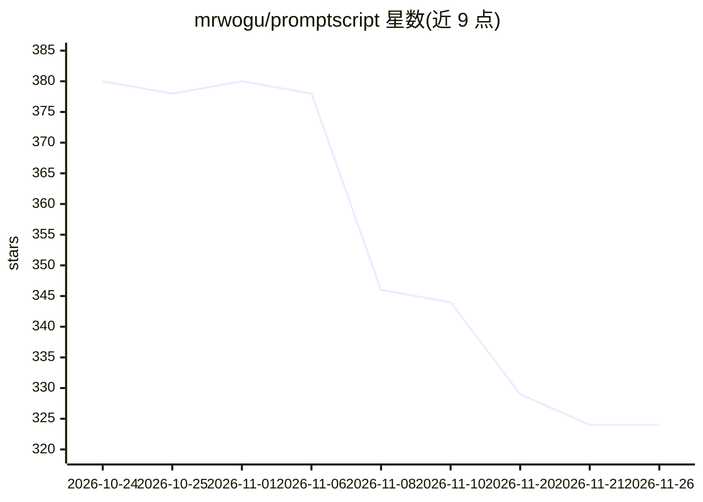

# mrwogu/promptscript

⭐ 324 · TypeScript · MIT · 推送 2026-11-23 · [GitHub](https://github.com/mrwogu/promptscript) · [官网](https://getpromptscript.dev/) · 个人维护

**AI 编码助手规则的统一源码编译器：一次编写，多工具部署**

开源的 AI 编码 agent 规则编译器：以 `.prs` 源文件定义指令、标准、限制、技能、agents、MCP 服务器、hooks 与策略，经继承解析、校验后编译为各 AI 工具的原生文件（如 CLAUDE.md、copilot-instructions.md、.cursor/rules 等 47+ 目标）。提供分层组合（@inherit/@use/@override）、版本化技能导入、模型别名映射、lockfile 锁定与离线 vendor 模式，CI 中可校验，无运行时代理。面向使用多个 AI 编码工具的个人开发者与需要统一规范的团队/平台组。

## 筛选速览

| 维度 | 判定 | 备注 |
|---|---|---|
| AI 角色 | `ai-ecosystem` | LLM/agent 周边工具 |
| 许可风险 | `permissive` | MIT |
| 部署形态 | `self-host` | docker 或自建部署 |
| 模型依赖 | — | README 未给出锁定关系 |
| 硬件要求 | — | 无带数字的原话,不猜 |
| 安装摩擦 | `low` | 无编译、无系统依赖或容器化 |
| 成熟度 | — | 结构信号不足 |

## 能力要点

- 单一源文件编译为 47+ AI 工具的原生规则文件
- @inherit/@use/@extend/@override 分层组合与确定性合并
- 模型别名映射：`opus` 等别名按目标工具写出正确模型名
- Remote imports 经 promptscript.lock 锁定，支持离线 vendor 模式

## 适用场景

- 团队同时使用 Claude Code、Copilot、Cursor 时统一维护规则源
- 平台组通过继承层向数百个仓库下发编码标准并在 CI 校验
- 以版本化方式共享可复用的 agent 技能目录
- 切换或新增 AI 编码工具时不重写规则源码

## 场景标签

`提示工程` · 领域:Agent 开发

## 证据(README 行号)

> L27: PromptScript is an open-source compiler for AI coding agent rules. `.prs` sources
> L48: One source of truth, Git-native review, validation in CI, deterministic output. No runtime proxy
> L117: `prs compile` maps supported capabilities to files each platform already understands:

## 星数曲线

2026-10-24 380 → 2026-11-26 324（-56）

---
*卡片 v1 · prompt 1.4 · 生成 2026-11-25 · 置信度 high · 依据 README sha `6160ba10107c` · [字段定义](../../DATASET.md)*
