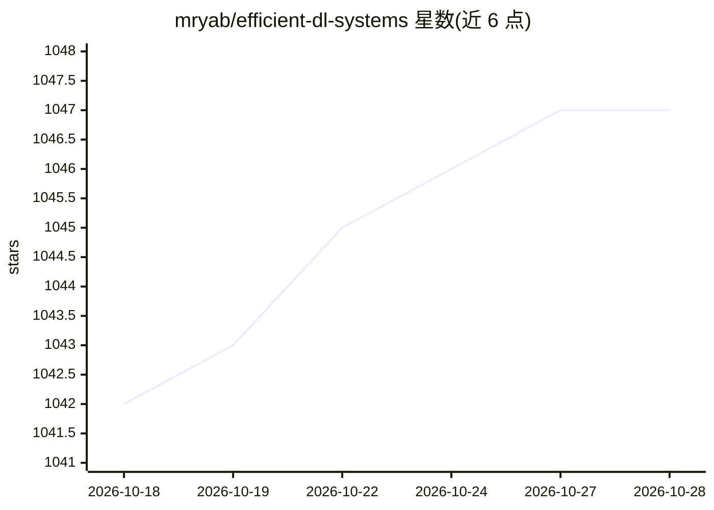

# mryab/efficient-dl-systems

⭐ 1,048 · Jupyter Notebook · MIT · 推送 2026-05-28 · [GitHub](https://github.com/mryab/efficient-dl-systems) · 组织维护

**深度学习系统效率化课程讲义与研讨材料合集**

HSE 大学计算机学院与 Yandex 数据分析学校开设的 Efficient Deep Learning Systems 课程仓库，本分支对应 2026 年课程。内容按 10 周大纲组织，覆盖 GPU 架构与 CUDA、PyTorch 混合精度与性能剖析、数据并行与 All-Reduce、张量/流水线并行、FSDP2、内核融合、推理优化（KV cache、连续批处理、FlashAttention、量化、投机解码）及服务部署；含多份课后作业与历年（2021–2025）材料索引，由 12 人团队授课。

## 筛选速览

| 维度 | 判定 | 备注 |
|---|---|---|
| AI 角色 | `ai-knowledge` | 知识聚合/清单类 |
| 许可风险 | `permissive` | MIT |
| 部署形态 | `None` |  |
| 模型依赖 | — | README 未给出锁定关系 |
| 硬件要求 | — | 无带数字的原话,不猜 |
| 安装摩擦 | `medium` | 含编译或系统依赖之一 |
| 成熟度 | — | 结构信号不足 |

## 能力要点

- 10 周课程大纲：从 CUDA 基础到分布式训练与推理优化
- 涉及 FSDP2、DTensor、torch.compile、FlashAttention、投机解码等主题的研讨材料
- 含训练管线剖析、分布式训练、生产部署三类课后作业
- 保留 2021–2025 历年课程材料索引

## 适用场景

- 系统学习深度学习训练与推理的性能优化方法
- 查找分布式训练与 LLM 服务优化的课程实践材料
- 作为高校 ML 系统课程的参考大纲

## 场景标签

`教程课程` · 领域:学习与行业

## 证据(README 行号)

> L2: This repository contains materials for the Efficient Deep Learning Systems course, taught at the Faculty of Computer
> L6: # Syllabus

## 星数曲线

2026-10-18 1,042 → 2026-10-28 1,047（+5）

---
*卡片 v1 · prompt 1.4 · 生成 2026-10-21 · 置信度 high · 依据 README sha `ec35d462729a` · [字段定义](../../DATASET.md)*
