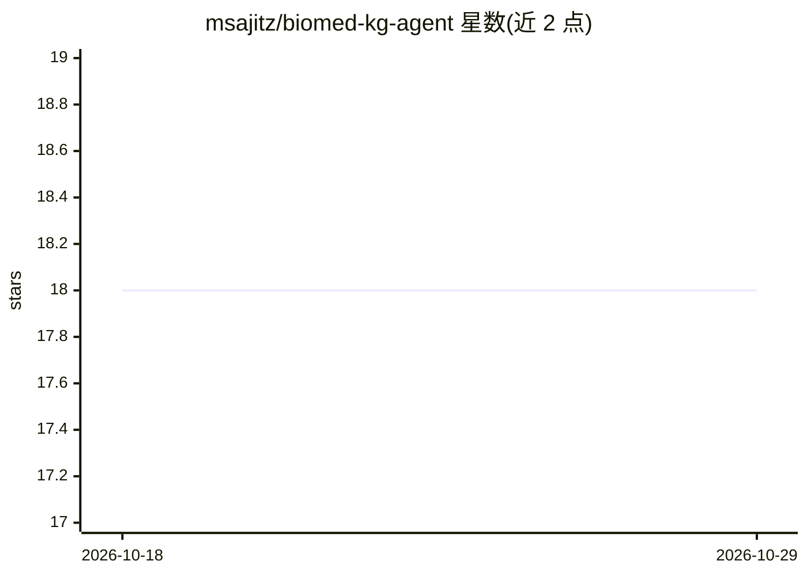

# msajitz/biomed-kg-agent

⭐ 18 · Python · Apache-2.0 · 推送 2026-03-04 · [GitHub](https://github.com/msajitz/biomed-kg-agent) · 个人维护

**从 PubMed 文献构建生物医学知识图谱并用 LLM agent 查询**

流水线式工具：经 PubMed API 抓取摘要，用多模型 scispaCy 集成做生物医学 NER 并经 UMLS 实体链接，抽取句级共现关系构建知识图谱，存于 SQLite 与 Neo4j；再通过 LLM agent（Anthropic Claude 模型）以自然语言查询图谱，回答附带文献文档出处，查询经预校验、不生成动态 Cypher。提供 Streamlit Web UI 与 Makefile 工作流，面向生物医学文献分析的研究探索用户。限制：16 GB 内存起步、agent/UI 需自建 Neo4j 5.x+ 与 Anthropic API key。

## 筛选速览

| 维度 | 判定 | 备注 |
|---|---|---|
| AI 角色 | `ai-native` | 本体是模型或模型工具 |
| 许可风险 | `permissive` | Apache-2.0 |
| 部署形态 | `None` |  |
| 模型依赖 | locked-api |  |
| 硬件要求 | `cpu-ok` | |
| 安装摩擦 | `low` | 无编译、无系统依赖或容器化 |
| 成熟度 | — | 结构信号不足 |

## 能力要点

- PubMed 摘要 → scispaCy 多模型 NER + UMLS 链接 → 共现知识图谱（SQL + Neo4j）
- LLM agent 自然语言查询，回答强制附带文档出处
- 预校验查询、不做动态 Cypher 生成
- Streamlit 交互界面与 make quick 5 分钟演示流水线

## 适用场景

- 查询基因与多种疾病的文献证据关联
- 检视某条图谱连接背后的支持文献
- 探索基因、疾病、化学物之间的共现模式

## 场景标签

`知识图谱` `科研工具` · 领域:知识与检索

## 证据(README 行号)

> L10: Synthesizing findings across thousands of biomedical papers is a manual bottleneck. This tool extracts entities and
> L64: - **LLM agent** for natural language research queries

## 星数曲线

2026-10-18 18 → 2026-10-29 18（+0）

---
*卡片 v1 · prompt 1.4 · 生成 2026-10-29 · 置信度 high · 依据 README sha `8e688b42fd0e` · [字段定义](../../DATASET.md)*
