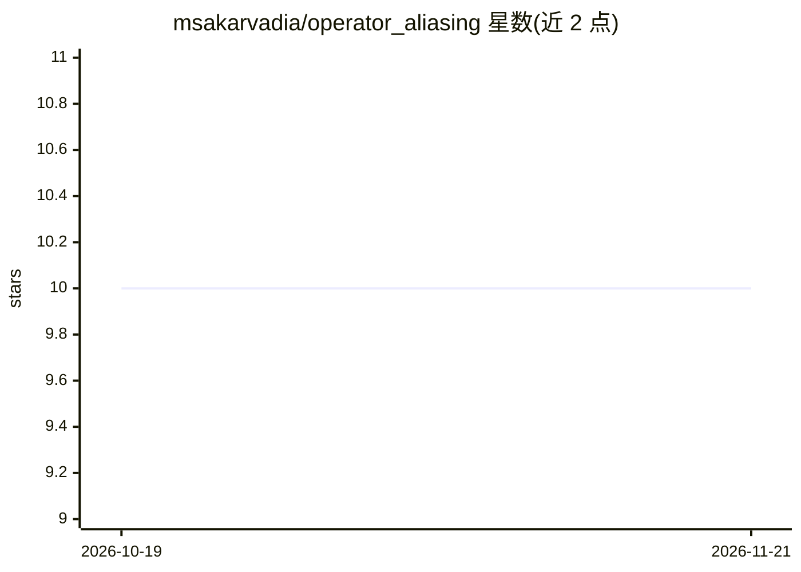

# msakarvadia/operator_aliasing

⭐ 10 · Jupyter Notebook · MIT · 推送 2026-11-16 · [GitHub](https://github.com/msakarvadia/operator_aliasing) · [官网](https://mansisak.com/operator_aliasing/) · 组织维护

**复现论文的实验代码：评估机器学习算子的多分辨率推理**

论文《The False Promise of Zero-Shot Super-Resolution in Machine-Learned Operators》的配套实验代码。仓库提供 main.py 单实验入口、demo.ipynb 演示笔记本（依赖 torch 与 neuraloperator），包含 Darcy Flow、Burgers、Incompressible Navier Stokes 数据的下载与处理脚本、模型定义、基于 parsl 的并行实验启动脚本，以及用 figures.ipynb 处理结果生成图表。面向科学机器学习研究者，通过 conda/pip 从源码安装。代码结构细节在各子目录的 README 中给出。

## 筛选速览

| 维度 | 判定 | 备注 |
|---|---|---|
| AI 角色 | `ai-native` | 本体是模型或模型工具 |
| 许可风险 | `permissive` | MIT |
| 部署形态 | `library` | 以包/库形式分发 |
| 模型依赖 | — | README 未给出锁定关系 |
| 硬件要求 | — | 无带数字的原话,不猜 |
| 安装摩擦 | `low` | 无编译、无系统依赖或容器化 |
| 成熟度 | — | 结构信号不足 |

## 能力要点

- main.py 默认在多分辨率 Darcy Flow（PDEBench）数据上训练 FNO
- demo.ipynb 覆盖零样本超分辨率、信息外推、分辨率插值、多分辨率训练四类实验
- 实验通过 parsl 框架并行化，默认配置面向 Perlmutter 机器
- 提供 BibTeX 引用信息

## 适用场景

- 复现论文中机器学习算子多分辨率推理的实验
- 在自己选择的实验配置下训练 FNO 并评估分辨率泛化
- 在 Darcy Flow/Burgers/Navier Stokes 数据上运行训练与数据处理流程

## 场景标签

 · 领域:科研/科学机器学习

## 证据(README 行号)

> L4: **Abstract:** A core challenge in scientific machine learning, and scientific computing more generally, is modeling 
> L14: - `main.py` allows you to run a single experiment w/ custom experimental configurations. Do `python main.py --help`
> L15: - `demo.ipynb` is a self-contained demo notebook (minimal dependancies: `torch`+`neuraloperator`) which does a repr

## 星数曲线

2026-10-19 10 → 2026-11-21 10（+0）

---
*卡片 v1 · prompt 1.4 · 生成 2026-11-19 · 置信度 high · 依据 README sha `ddfcb216d464` · [字段定义](../../DATASET.md)*
