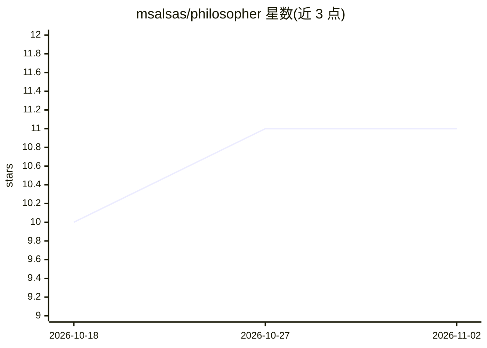

# msalsas/philosopher

⭐ 11 · Python · MIT · 推送 2026-10-17 · [GitHub](https://github.com/msalsas/philosopher) · 个人维护

**对话式 AI 毛绒玩具：笔记本跑大脑，树莓派做身体**

两个独立 Python 项目经 WebSocket 通信的 DIY 对话玩具：笔记本端（philosopher-server）承担 faster-whisper 语音识别、dlib 人脸身份与 FER+ ONNX 情绪识别、Kokoro/Piper/Edge 文字转语音、LangGraph 对话流水线与按人分离的双层记忆；树莓派 Zero WH 端（philosopher-toy）无任何 ML，仅处理麦克风、摄像头、扬声器与头部舵机。LLM 通过任意 OpenAI 兼容端点接入，可完全离线本地运行。面向具备一定动手能力的开发者与硬件爱好者，需自行购置硬件并完成装配。

## 筛选速览

| 维度 | 判定 | 备注 |
|---|---|---|
| AI 角色 | `ai-native` | 本体是模型或模型工具 |
| 许可风险 | `permissive` | MIT |
| 部署形态 | `library` | 以包/库形式分发 |
| 模型依赖 | local-ok | 支持本地模型 |
| 硬件要求 | — | 无带数字的原话,不猜 |
| 安装摩擦 | `high` | 编译与系统依赖俱全 |
| 成熟度 | — | 结构信号不足 |

## 能力要点

- STT·人脸/情绪识别·TTS·LangGraph 流水线·双层记忆全部跑在笔记本端
- 支持任意 OpenAI 兼容端点（Ollama/llama.cpp/vLLM/LM Studio/OpenAI），可 100% 本地离线
- 按人 keyed 的人脸识别与长期记忆，多人共用一个玩具
- 人格以 YAML 文件定义，无代码即可新增；提供 MOCK_MODE 无硬件运行

## 适用场景

- 自制一个能认人、读情绪、有人格的对话毛绒玩具
- 给孩子或家人做一个完全本地、无云端的语音陪伴玩具
- 在无硬件时用 MOCK 模式与 fake_toy 驱动端到端流程做开发调试

## 场景标签

 · 领域:机器人/嵌入式 AI 应用

## 证据(README 行号)

> L5: **A conversational-AI plush toy that recognizes your face, reads your mood, remembers you, and talks back — with a p
> L38: - **`philosopher-server/`** — the brain. Does everything: speech-to-text
> L41:  memory, personality, and proxying an external LLM. Exposes a WebSocket for the

## 星数曲线

2026-10-18 10 → 2026-11-02 11（+1）

---
*卡片 v1 · prompt 1.4 · 生成 2026-11-02 · 置信度 high · 依据 README sha `3d756bd652e4` · [字段定义](../../DATASET.md)*
