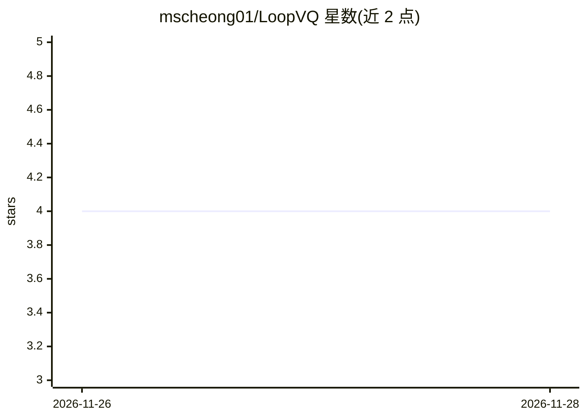

# mscheong01/LoopVQ

⭐ 4 · Python · Apache-2.0 · 推送 2026-11-11 · [GitHub](https://github.com/mscheong01/LoopVQ) · [官网](https://mscheong01.github.io/loopvq/) · 个人维护

**循环 Transformer 的 KV 缓存亚 1-bit 量化方法官方代码**

论文 LoopVQ 的官方实现：针对循环 transformer 每个循环步各自持有 KV 缓存导致的显存增长问题，提供 loop 轴向量量化（跨循环步共享码本索引）与 loop-aware 微调（Fisher 加权 k-means 码本对齐全精度输出）。仓库包含校准流水线、基于 SGLang 的推理引擎（打包索引存储与融合解码内核），以及论文各表格在 Ouro-1.4B/2.6B（含 Thinking）与 Huginn-3.5B 上的复现脚本。提供 0.25/0.5 比特及 1/2/4 比特扫描多种量化配置，服务端暴露 SGLang 的 OpenAI 兼容 API。

## 筛选速览

| 维度 | 判定 | 备注 |
|---|---|---|
| AI 角色 | `ai-native` | 本体是模型或模型工具 |
| 许可风险 | `permissive` | Apache-2.0 |
| 部署形态 | `None` |  |
| 模型依赖 | — | README 未给出锁定关系 |
| 硬件要求 | — | 无带数字的原话,不猜 |
| 安装摩擦 | `low` | 无编译、无系统依赖或容器化 |
| 成熟度 | — | 结构信号不足 |

## 能力要点

- Loop 轴向量量化：多个连续循环步的通道组成子向量，共享码本索引
- Loop-aware 微调：量化模型对齐全精度输出的 Fisher 加权 k-means 码本
- 基于 SGLang 的推理引擎，含打包索引存储与融合解码内核
- 论文全部实验表格（通用/推理/长上下文/LongBench/消融/效率）的复现脚本

## 适用场景

- 为 Looped Transformer（Ouro/Huginn）压缩 KV 缓存以降低显存占用
- 复现论文中 0.25/0.5 bit 亚 1-bit 量化的基准结果
- 研究推理模型部署时 KV 缓存量化对推理基准的影响

## 场景标签

`微调` `模型量化` `推理引擎` · 领域:训练与推理

## 证据(README 行号)

> L5: Project Page
> L28: pipeline, an SGLang-based serving engine with packed index storage and fused decode kernels, and the
> L107: |Table|Directory|Models|Benchmarks|

## 星数曲线

2026-11-26 4 → 2026-11-28 4（+0）

---
*卡片 v1 · prompt 1.4 · 生成 2026-11-26 · 置信度 high · 依据 README sha `b193564cb5e6` · [字段定义](../../DATASET.md)*
