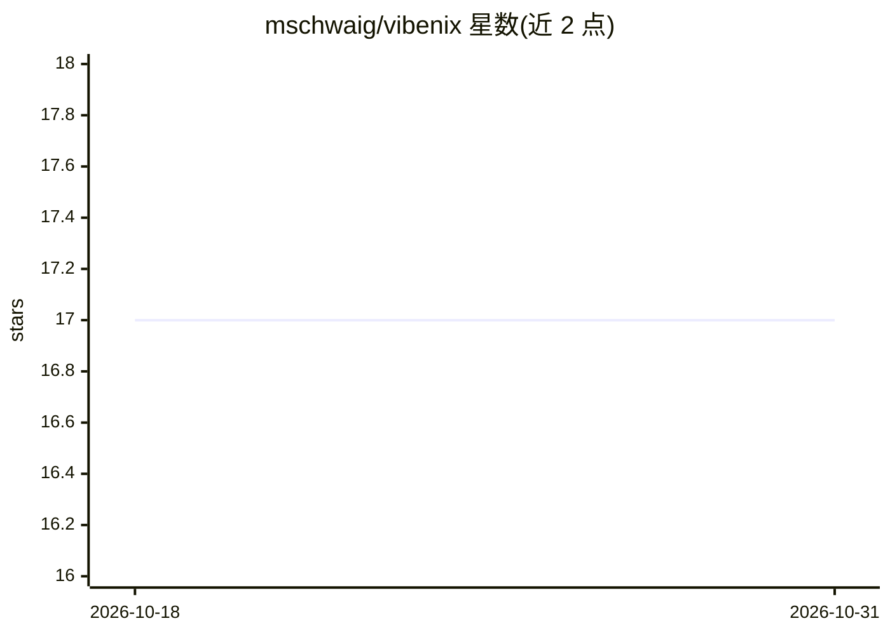

# mschwaig/vibenix

⭐ 17 · Python · AGPL-3.0 · 推送 2026-07-14 · [GitHub](https://github.com/mschwaig/vibenix) · 个人维护

**AI 助手：从 GitHub 项目 URL 自动生成 Nix 打包表达式**

面向 Nix 打包工作的 AI 助手：用户提供 GitHub 项目 URL，工具从模板出发迭代改进 Nix 打包配置，直到构建成功或失败为止。通过 nix develop 环境以 Python 模块方式运行，默认提供终端 UI，另有 --textual 标志的 Textual UI（README 注明未维护、不推荐使用）。运行时需选择模型并按需提供 API key。作者计划基于此工作发表论文，并设想以托管服务形式提供该功能。

## 筛选速览

| 维度 | 判定 | 备注 |
|---|---|---|
| AI 角色 | `ai-native` | 本体是模型或模型工具 |
| 许可风险 | `viral` | AGPL-3.0 |
| 部署形态 | `None` |  |
| 模型依赖 | — | README 未给出锁定关系 |
| 硬件要求 | — | 无带数字的原话,不猜 |
| 安装摩擦 | `low` | 无编译、无系统依赖或容器化 |
| 成熟度 | — | 结构信号不足 |

## 能力要点

- 从模板出发迭代改进 Nix 打包配置直至构建成功
- 默认终端 UI，运行时选择模型并按需提供 API key
- 基于 nix develop 的运行方式

## 适用场景

- 为 GitHub 上的项目自动生成 Nix 打包表达式
- 减少手写 Nix 包配置的迭代工作量

## 场景标签

`AI 助手` `代码生成` · 领域:编码与开发

## 证据(README 行号)

> L1: # Vibenix - AI assistant for nix packaging
> L4: and it starts from a template and iteratively improves on that until it finally succeeds (or fails) to build the pac

## 星数曲线

2026-10-18 17 → 2026-10-31 17（+0）

---
*卡片 v1 · prompt 1.4 · 生成 2026-10-29 · 置信度 mid · 依据 README sha `5ed15fe00c38` · [字段定义](../../DATASET.md)*
