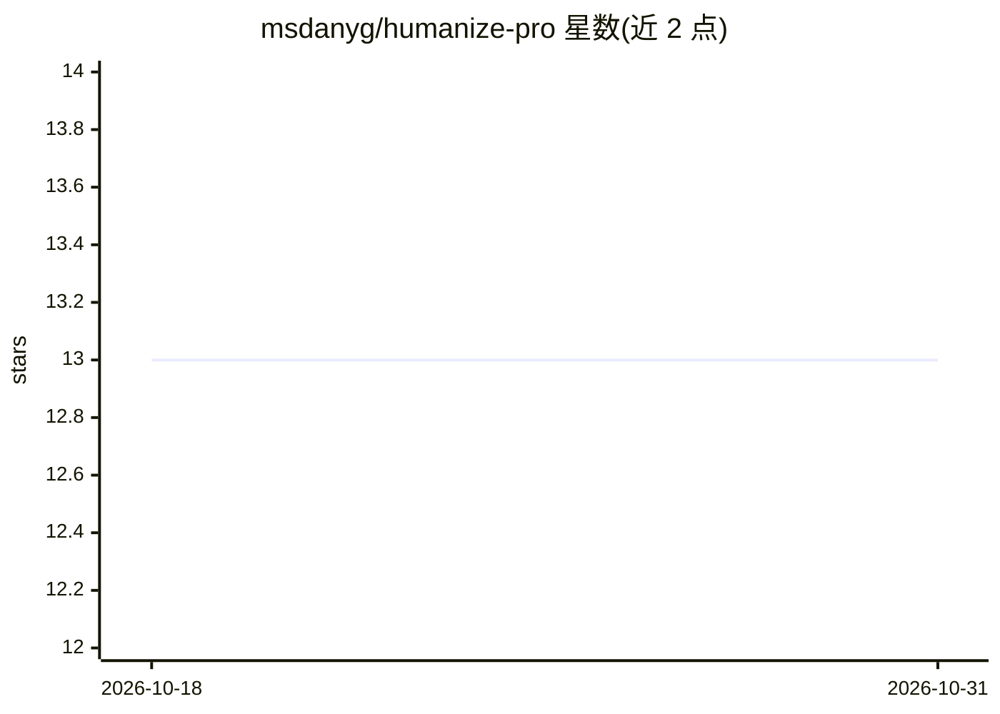

# msdanyg/humanize-pro

⭐ 13 · MIT · 推送 2026-09-10 · [GitHub](https://github.com/msdanyg/humanize-pro) · [官网](https://github.com/msdanyg/humanize-pro#readme) · 个人维护

**Claude 技能：改写 AI 起草文本使其符合渠道与个人文风**

面向 Claude、Claude Code 与 Claude Agent SDK 的写作技能，用于去除文本中的 AI 特征（词汇、句式、标点、结构），并按 LinkedIn、X、邮件、Slack、博客等渠道规范重塑文本。机制含四步：去 AI 化、渠道适配、基于用户写作样本的版本化声音档案（优先于内置规则）、两道门审计；全程执行不编造事实规则。通过 Claude Code 插件市场命令安装，Claude.ai 需手动打包上传。参考文件为纯 markdown，可粘贴进其他模型系统提示。

## 筛选速览

| 维度 | 判定 | 备注 |
|---|---|---|
| AI 角色 | `ai-native` | 本体是模型或模型工具 |
| 许可风险 | `permissive` | MIT |
| 部署形态 | `None` |  |
| 模型依赖 | locked-api |  |
| 硬件要求 | — | 无带数字的原话,不猜 |
| 安装摩擦 | `low` | 无编译、无系统依赖或容器化 |
| 成熟度 | — | 结构信号不足 |

## 能力要点

- 去除词汇/结构/标点等全类 AI 特征并做渠道适配（10+ 渠道规范）
- 从用户写作与编辑中学习并维护版本化声音档案
- 两道门自审计：逐字扫描 + 冷读判定
- 明确的不编造规则：缺失的数字/引语/事例只标记不填补

## 适用场景

- 把 AI 起草的邮件或 Slack 回复改得更像本人写的
- 为不同发布渠道（LinkedIn、X、博客等）调整文风与结构
- 审计已有文本中的 AI 特征并逐条给出修改
- 从自己的写作样本建立个人声音档案供长期使用

## 场景标签

`AI 写作` · 领域:内容生成

## 证据(README 行号)

> L9: humanize-pro is a skill for Claude, Claude Code, and the Claude Agent SDK. It removes the tells that make writing re
> L76: - **Rewrite**: paste text, get the fixed version back, nothing else.

## 星数曲线

2026-10-18 13 → 2026-10-31 13（+0）

---
*卡片 v1 · prompt 1.4 · 生成 2026-10-31 · 置信度 high · 依据 README sha `75a9486ef4bf` · [字段定义](../../DATASET.md)*
