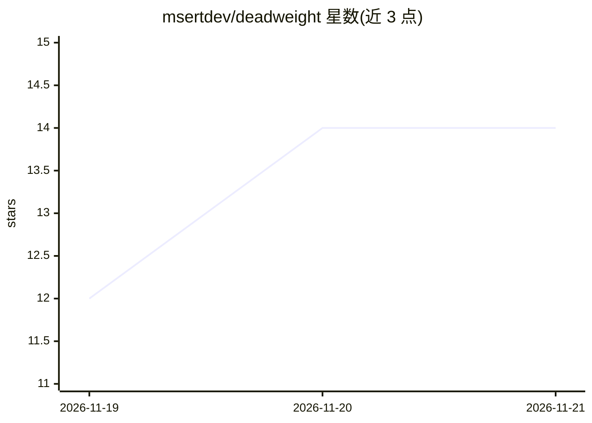

# msertdev/deadweight

⭐ 14 · Rust · MIT · 推送 2026-11-19 · [GitHub](https://github.com/msertdev/deadweight) · [官网](https://github.com/msertdev/deadweight) · 个人维护

**为 Claude Code 用户审计并清理每请求 token 开销**

用 Rust 编写的单二进制 CLI，读取本地 Claude Code 会话记录，测量每个请求在用户输入前携带的 token 开销，将其归因到具体插件、技能、MCP 服务器或 hook，扫描最近 30 天记录判断实际使用情况，并通过可撤销的 fix 命令停用未使用项。默认只读、不联网、不读取密钥，所有修改前备份 settings.json，支持以 Claude Code 插件形式运行。非 Anthropic 官方工具。

## 筛选速览

| 维度 | 判定 | 备注 |
|---|---|---|
| AI 角色 | `ai-ecosystem` | LLM/agent 周边工具 |
| 许可风险 | `permissive` | MIT |
| 部署形态 | `library` | 以包/库形式分发 |
| 模型依赖 | — | README 未给出锁定关系 |
| 硬件要求 | — | 无带数字的原话,不猜 |
| 安装摩擦 | `low` | 无编译、无系统依赖或容器化 |
| 成熟度 | — | 结构信号不足 |

## 能力要点

- 测量每个请求的起始 token 开销并逐项归因到插件/技能/MCP/hook
- 扫描 30 天会话记录判定技能与 MCP 工具的实际使用情况
- fix/undo 可撤销修改，默认只读且修改前备份
- 以 cargo 安装或预编译二进制分发，无运行时依赖

## 适用场景

- 排查 Claude Code 用量配额为何消耗过快
- 清理从未使用的插件与技能以缩短上下文占用
- 诊断失效或未认证的 MCP 服务器与重复技能名

## 场景标签

 · 领域:开发者工具/LLM 配置审计

## 证据(README 行号)

> L5: Every plugin, skill, MCP server and hook you install adds text to *every single request* Claude Code sends, before y
> L63: ## Use it from inside Claude Code
> L77: Claude Code keeps a transcript of every session in `~/.claude/projects/`. Alongside the conversation it records wha

## 星数曲线

2026-11-19 12 → 2026-11-21 14（+2）

---
*卡片 v1 · prompt 1.4 · 生成 2026-11-19 · 置信度 high · 依据 README sha `998c021a3d00` · [字段定义](../../DATASET.md)*
