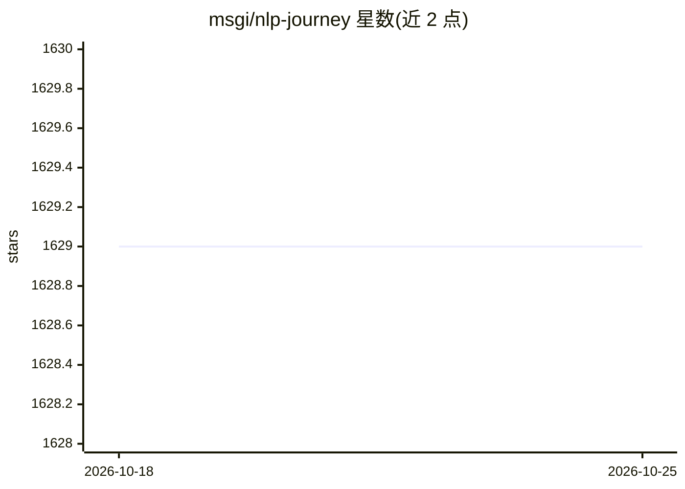

# msgi/nlp-journey

⭐ 1,629 · Python · Apache-2.0 · 推送 2026-02-11 · [GitHub](https://github.com/msgi/nlp-journey) · [官网](https://github.com/msgi/nlp-journey) · 个人维护

**NLP 论文与学习资源清单：覆盖 12 类研究主题**

自然语言处理方向的论文与资源聚合仓库，按书籍、论文、文章、GitHub 项目四部分组织。论文部分划分 12 个主题：Transformer 模型、基础模型、综述、预训练、文本分类、文本生成、文本相似度、问答、机器翻译、摘要、关系抽取与大语言模型，收录 BERT、GPT-3、LLaMA 等论文条目及在线阅读链接；另列出 Transformer/LSTM 图解等教程文章与 CLUE、transformers、HanLP 等代码仓库链接。条目以链接索引形式提供，仓库本身不含可运行代码或安装说明。

## 筛选速览

| 维度 | 判定 | 备注 |
|---|---|---|
| AI 角色 | `ai-knowledge` | 知识聚合/清单类 |
| 许可风险 | `permissive` | Apache-2.0 |
| 部署形态 | `None` |  |
| 模型依赖 | — | README 未给出锁定关系 |
| 硬件要求 | — | 无带数字的原话,不猜 |
| 安装摩擦 | `low` | 无编译、无系统依赖或容器化 |
| 成熟度 | — | 结构信号不足 |

## 能力要点

- 12 个 NLP 主题分类的论文索引，含预训练、问答、关系抽取、LLM 等
- 附 4 本在线书籍与多篇图解教程文章链接
- 收录 CLUE、transformers、HanLP 等 GitHub 项目链接

## 适用场景

- 按主题查找 NLP 经典与前沿论文
- 系统学习 NLP 各研究方向的知识脉络
- 寻找 NLP 相关的开源代码仓库入口

## 场景标签

`精选清单` `教程课程` · 领域:学习与行业

## 证据(README 行号)

> L19: ## 2. Papers
> L21: ### 01) Transformer papers

## 星数曲线

2026-10-18 1,629 → 2026-10-25 1,629（+0）

---
*卡片 v1 · prompt 1.4 · 生成 2026-10-21 · 置信度 high · 依据 README sha `a0d8245756fa` · [字段定义](../../DATASET.md)*
