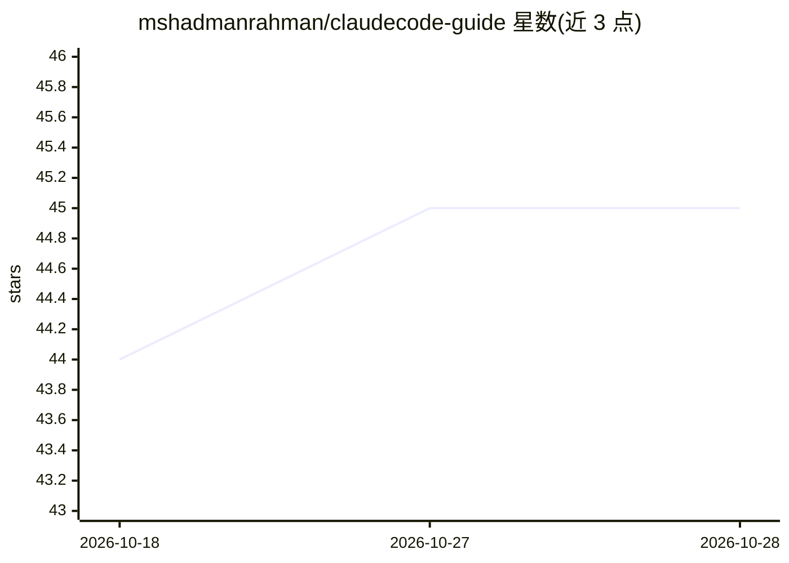

# mshadmanrahman/claudecode-guide

⭐ 45 · TypeScript · MIT · 推送 2026-10-26 · [GitHub](https://github.com/mshadmanrahman/claudecode-guide) · [官网](https://claudecodeguide.dev) · 个人维护

**面向初学者到团队负责人的 Claude Code 使用指南站**

发布于 claudecodeguide.dev 的 Claude Code 实践教程网站：34 页 5 大章节，覆盖 CLAUDE.md 配置、会话管理、权限、MCP Servers、子代理、CI/CD 等主题，配 45+ 交互式终端演示，另含 15 个面向不同受众（开发者、PM、无终端用户）的动手教程，以及与 Cursor、GitHub Copilot 等的对比章节。读者无需安装或克隆本仓库，直接访问网站阅读。作者同系列还维护 pm-pilot 等配套工具。

## 筛选速览

| 维度 | 判定 | 备注 |
|---|---|---|
| AI 角色 | `ai-knowledge` | 知识聚合/清单类 |
| 许可风险 | `permissive` | MIT |
| 部署形态 | `None` |  |
| 模型依赖 | — | README 未给出锁定关系 |
| 硬件要求 | — | 无带数字的原话,不猜 |
| 安装摩擦 | `low` | 无编译、无系统依赖或容器化 |
| 成熟度 | — | 结构信号不足 |

## 能力要点

- 34 页 5 章节内容，含 45+ 交互式终端演示
- 15 个动手教程，覆盖开发者/PM/无终端用户
- 与 Cursor、GitHub Copilot、Windsurf、Codex、Gemini CLI 的对比章节
- 配套 PM Toolkit 工具族（pm-pilot、root-kg 等）

## 适用场景

- 初次安装 Claude Code 后不知道下一步怎么做的用户入门
- 团队负责人制定可复制的 Claude Code 推广手册
- PM 用模板和教程完成需求发现、会议纪要转工单等工作

## 场景标签

`教程课程` · 领域:学习与行业

## 证据(README 行号)

> L5: **The practitioner's guide to Claude Code.**
> L44: The guide is 34 pages across 5 sections, plus **15 hands-on tutorials** for every audience. Here's the full table o

## 星数曲线

2026-10-18 44 → 2026-10-28 45（+1）

---
*卡片 v1 · prompt 1.4 · 生成 2026-10-25 · 置信度 high · 依据 README sha `482fdb31d1e6` · [字段定义](../../DATASET.md)*
