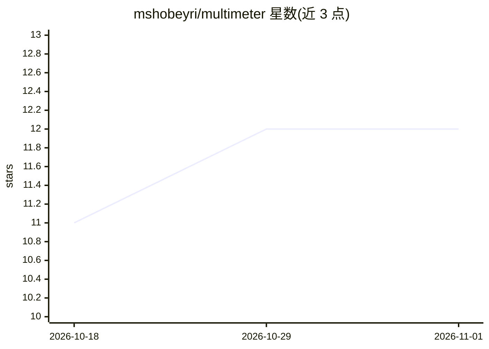

# mshobeyri/multimeter

⭐ 12 · TypeScript · Apache-2.0 · 推送 2026-10-29 · [GitHub](https://github.com/mshobeyri/multimeter) · [官网](https://mmt.dev) · 个人维护

**给 API 开发者：VS Code 内 Git 原生的 REST 客户端与 API 测试工具**

以 YAML .mmt 文件为中心的 API 测试工具：请求、测试套件、Mock 服务器、文档、报告均以文件形式存于 Git 仓库，本地与 CI 使用同一套文件。支持 HTTP、WebSocket、GraphQL、gRPC，通过 testlight CLI 与 GitHub Action 运行 CI。AI 部分：经 MCP（mmt-mcp）让 Cursor、Copilot、Claude 生成并运行 .mmt 测试文件，AI Judge 用语义相似度或开放式判据评估 API 回复，可接入自带模型（Ollama 或云端）。以 VS Code 扩展形式安装，CLI 经 npm 分发。

## 筛选速览

| 维度 | 判定 | 备注 |
|---|---|---|
| AI 角色 | `ai-enhanced` | 去掉 AI 部分产品仍成立 |
| 许可风险 | `permissive` | Apache-2.0 |
| 部署形态 | `library` | 以包/库形式分发 |
| 模型依赖 | local-ok | 支持本地模型 |
| 硬件要求 | — | 无带数字的原话,不猜 |
| 安装摩擦 | `low` | 无编译、无系统依赖或容器化 |
| 成熟度 | — | 结构信号不足 |

## 能力要点

- 请求/测试/Mock/文档/报告统一为 Git 中的 YAML .mmt 文件
- 支持 HTTP、WebSocket、GraphQL、gRPC 与多步骤测试流程
- MCP 提供 scaffold_test、validate、format、run 工具供 AI 编辑器生成测试
- AI Judge 评估 API 回复，支持自带模型（Ollama 或云端）

## 适用场景

- 在 VS Code 里以文件形式编写和运行 API 请求与测试
- 用 AI 编辑器从 API 或描述生成测试并纳入版本控制
- 在 CI 中用 testlight 或 GitHub Action 运行同一套 .mmt 文件

## 场景标签

 · 领域:开发者工具/API 测试

## 证据(README 行号)

> L39: **Multimeter** is Git-native API testing in VS Code. Requests, tests, mocks, and docs are YAML `.mmt` files in your
> L67: - ✅ Generate tests from an API or a description (Cursor, Copilot, Claude via MCP)
> L133: **Judge** an API answer in the same test. Compare semantic similarity to an expected reply, or check something ope

## 星数曲线

2026-10-18 11 → 2026-11-01 12（+1）

---
*卡片 v1 · prompt 1.4 · 生成 2026-11-01 · 置信度 high · 依据 README sha `e481ee6f167f` · [字段定义](../../DATASET.md)*
