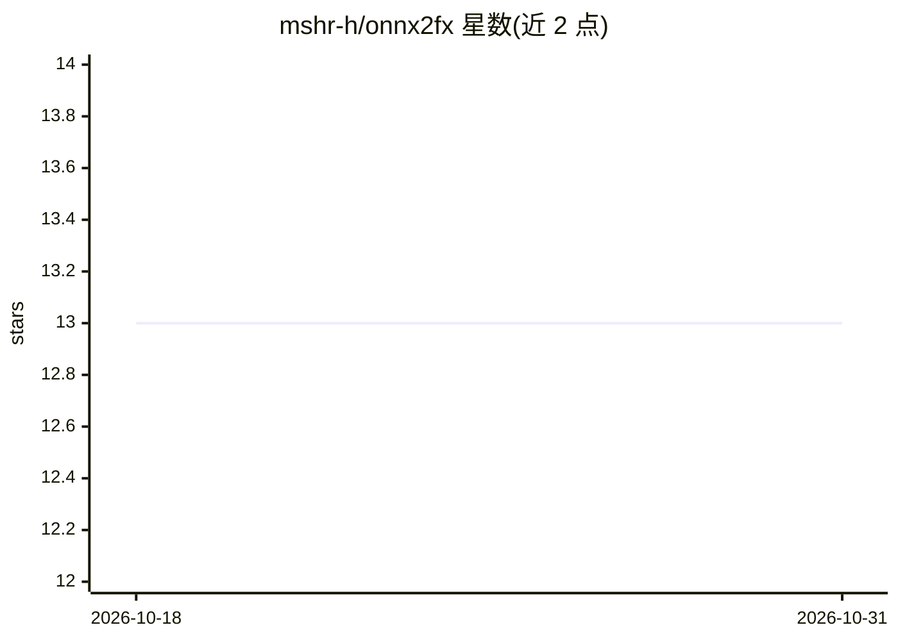

# mshr-h/onnx2fx

⭐ 13 · Python · Apache-2.0 · 推送 2026-05-14 · [GitHub](https://github.com/mshr-h/onnx2fx) · 个人维护

**把 ONNX 模型转换为 PyTorch FX GraphModule 的转换库**

面向 PyTorch 开发者的模型转换 Python 库：将 ONNX 模型（文件路径或 ModelProto）转换为 torch.fx.GraphModule，输出可检视、可优化、可编译的图模块。覆盖标准 ONNX 域及 com.microsoft 域算子，支持多 opset 版本自动选择、动态形状、量化算子，可注册自定义算子处理器，提供 make_trainable() 将权重转为可训练参数及 analyze_model() 兼容性分析。要求 Python>=3.11、PyTorch>=2.9.0、ONNX>=1.19.1；README 声明项目处于活跃开发期，公开 API 可能随时变动。

## 筛选速览

| 维度 | 判定 | 备注 |
|---|---|---|
| AI 角色 | `ai-ecosystem` | LLM/agent 周边工具 |
| 许可风险 | `permissive` | Apache-2.0 |
| 部署形态 | `library` | 以包/库形式分发 |
| 模型依赖 | — | README 未给出锁定关系 |
| 硬件要求 | — | 无带数字的原话,不猜 |
| 安装摩擦 | `low` | 无编译、无系统依赖或容器化 |
| 成熟度 | `idea` | |

## 能力要点

- ONNX → torch.fx.GraphModule 单函数转换
- 标准域与 com.microsoft 域算子覆盖，多 opset 自动选择
- register_op 注册自定义算子，make_trainable() 开启训练
- analyze_model() 转换前算子支持分析

## 适用场景

- 把 ONNX 导出的模型接回 PyTorch 生态做优化或分析
- 转换后继续微调 ONNX 模型
- 转换前检查模型的算子兼容性

## 场景标签

 · 领域:深度学习/模型转换工具

## 证据(README 行号)

> L3: Turn ONNX models into inspectable, transformable, and trainable PyTorch FX GraphModules.
> L7: `onnx2fx` converts ONNX models into PyTorch FX `GraphModule`s, enabling seamless integration with PyTorch's ecosyste

## 星数曲线

2026-10-18 13 → 2026-10-31 13（+0）

---
*卡片 v1 · prompt 1.4 · 生成 2026-10-31 · 置信度 high · 依据 README sha `10705cde5fc7` · [字段定义](../../DATASET.md)*
