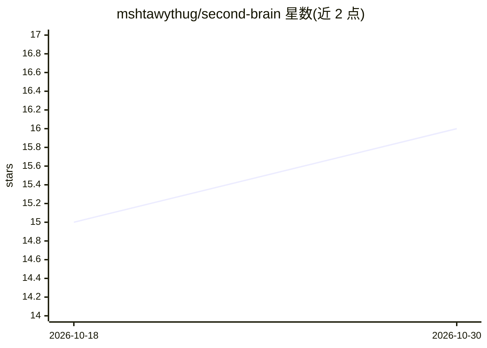

# mshtawythug/second-brain

⭐ 16 · Python · MIT · 推送 2026-10-29 · [GitHub](https://github.com/mshtawythug/second-brain) · 个人维护

**本地优先的个人知识库 CLI，供人与 AI agent 查询笔记与通信记录**

将 Markdown 笔记、PDF/DOCX、Krisp 转写、Slack 线程与 Gmail 存入 Postgres + pgvector，通过 `brain` CLI、本地 Web UI 与内置 `brain-mcp` MCP 服务器查询。提供 FTS+向量混合搜索、GraphRAG 实体图、LLM 增强与带引用的多跳问答（`brain ask`），以及摘要、复习、笔记关联等主动功能。默认全本地运行于 Ollama，无需云服务与 API key；confidential 分级控制文档出站。运行需 Docker（Postgres 容器）与 Python 3.11+。

## 筛选速览

| 维度 | 判定 | 备注 |
|---|---|---|
| AI 角色 | `ai-native` | 本体是模型或模型工具 |
| 许可风险 | `permissive` | MIT |
| 部署形态 | `library` | 以包/库形式分发 |
| 模型依赖 | local-ok | 支持本地模型 |
| 硬件要求 | — | 无带数字的原话,不猜 |
| 安装摩擦 | `low` | 无编译、无系统依赖或容器化 |
| 成熟度 | — | 结构信号不足 |

## 能力要点

- FTS + pgvector 混合搜索与 GraphRAG 实体图
- 内置 brain-mcp MCP 服务器，任何支持 MCP 的 agent 可查询
- brain ask 生成分步子查询并给出带 [N] 引用的合成回答
- confidential 敏感度分级作为出站控制，阻止机密内容离开本机

## 适用场景

- 把职业文档、会议转写、Slack/Gmail 集中为可搜索的个人知识库
- 让 Claude 等 AI agent 通过 MCP 直接查询我的笔记，免去反复粘贴上下文
- 对长邮件线程和转写做片段级检索以节省 token
- 标记机密文档并控制其不出现在 agent 响应与 Web UI 之外

## 场景标签

`知识库管理` `文档问答` `语义搜索` · 领域:知识与检索

## 证据(README 行号)

> L12: Stores career docs, interview prep, Krisp transcripts, Slack threads, Gmail, and authored Markdown notes in Postgre
> L120: `brain ask` closes the loop. Instead of a ranked list you read yourself, it plans sub-queries, retrieves across it
> L154: `brain` and the bundled `brain-mcp` server are harness-agnostic — any agent that runs a shell command or speaks MC

## 星数曲线

2026-10-18 15 → 2026-10-30 16（+1）

---
*卡片 v1 · prompt 1.4 · 生成 2026-10-30 · 置信度 high · 依据 README sha `bc047c08b2ac` · [字段定义](../../DATASET.md)*
