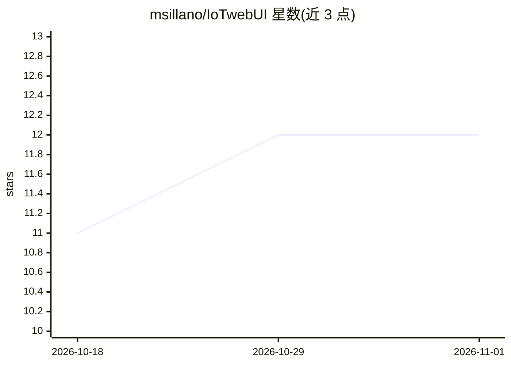

# msillano/IoTwebUI

⭐ 12 · JavaScript · MIT · 推送 2026-03-16 · [GitHub](https://github.com/msillano/IoTwebUI) · 个人维护

**给智能家居用户的 Tuya 设备 Web 管理应用，含 AI 聊天接口**

面向 Tuya/SmartLife 用户的 Web 应用：提供可定制的设备控制界面、历史数据导出、超越 Tuya 自身限制的 RULE 自动化、个性化告警与语音控制。面向 power user 提供 REST 服务器、自定义 WEB 页面、可递归组合的虚拟 x-device 与 Addon（含 NiMH 电池测试器、5 通道逻辑分析器示例）。3.1 版新增连接 Tuya 设备的 AI 聊天接口。README 提供英/意双语，未包含具体安装步骤。

## 筛选速览

| 维度 | 判定 | 备注 |
|---|---|---|
| AI 角色 | `ai-enhanced` | 去掉 AI 部分产品仍成立 |
| 许可风险 | `permissive` | MIT |
| 部署形态 | `None` |  |
| 模型依赖 | — | README 未给出锁定关系 |
| 硬件要求 | — | 无带数字的原话,不猜 |
| 安装摩擦 | `low` | 无编译、无系统依赖或容器化 |
| 成熟度 | — | 结构信号不足 |

## 能力要点

- RULE 自动化与个性化实时告警
- REST 服务器与自定义 WEB 页面（power user）
- 可递归组合的虚拟 x-device 与 Addon 机制
- 3.1 版新增连接 Tuya 设备的 AI 聊天接口

## 适用场景

- 在一个界面集中管理全部 Tuya 智能家居设备
- 导出设备历史数据做自己的分析
- 创建超出 Tuya/SmartLife 限制的复杂自动化

## 场景标签

`聊天机器人` · 领域:对话与助手

## 证据(README 行号)

> L1: ## IoTwebUI: Tuya WebApp open extension
> L23: - **chatbot** interface for AI connected with Tuya devices! see **/IoTwebUI AI**

## 星数曲线

2026-10-18 11 → 2026-11-01 12（+1）

---
*卡片 v1 · prompt 1.4 · 生成 2026-11-01 · 置信度 mid · 依据 README sha `2415c566c7ba` · [字段定义](../../DATASET.md)*
