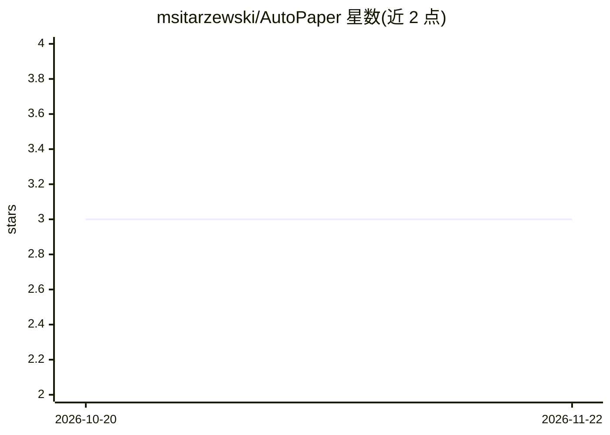

# msitarzewski/AutoPaper

⭐ — · [GitHub]() · 个人维护

**桌面 AI 壁纸生成应用：用关键词持续产出桌面壁纸**

面向 macOS、Windows 与 Linux 的原生桌面应用，用户给出若干关键词（Must/Maybe/Avoid 与 Surprise 自由度），由语言模型写出场景描述，再交给所选图像生成服务绘制并设为壁纸。内置记忆与回声机制避免重复并偏好用户喜欢的方向，支持小时/天/周级定时与手动生成，含历史画廊与月度预算记录。写作与绘画均可选本地模型（Ollama、ComfyUI）实现全离线；三端共享一个 Rust 核心，各端用原生 UI 框架构建。

## 筛选速览

| 维度 | 判定 | 备注 |
|---|---|---|
| AI 角色 | `ai-native` | 本体是模型或模型工具 |
| 许可风险 | `permissive` | — |
| 部署形态 | `desktop` | 安装包/桌面程序 |
| 模型依赖 | local-ok | 支持本地模型 |
| 硬件要求 | — | 无带数字的原话,不猜 |
| 安装摩擦 | `high` | 编译与系统依赖俱全 |
| 成熟度 | — | 结构信号不足 |

## 能力要点

- 关键词到壁纸的管线：关键词→LLM 写场景→图像模型绘制→设为桌面
- 记忆、回声、Taste（赞/踩）与 Moods 关键词组机制
- 支持本地全离线路径：Ollama 写作 + ComfyUI 绘画
- 三平台原生应用（SwiftUI / WinUI 3 / GTK4+libadwaita）共享 Rust 核心

## 适用场景

- 定期自动更换个性化桌面壁纸
- 用本地模型在离线环境下生成壁纸
- 按关键词主题（mood）管理不同风格的壁纸系列

## 场景标签

`图像生成` · 领域:内容生成

## 证据(README 行号)

> L24: AutoPaper is a desktop app for **macOS, Windows and Linux** that keeps making new wallpapers you're unlikely to see
> L79: - **Local all the way, if you like.** With Ollama writing and ComfyUI painting, nothing leaves your network. ComfyU
> L133: |Provider|Writes|Paints|Key|

## 星数曲线

2026-10-20 3 → 2026-11-22 3（+0）

---
*卡片 v1 · prompt 1.4 · 生成 2026-11-21 · 置信度 high · 依据 README sha `0debf2667f9b` · [字段定义](../../DATASET.md)*
