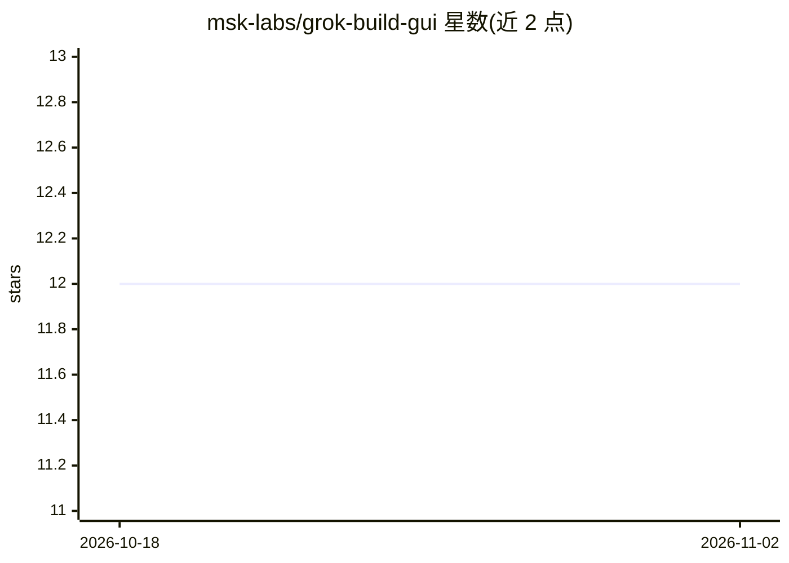

# msk-labs/grok-build-gui

⭐ 12 · TypeScript · MIT · 推送 2026-08-25 · [GitHub](https://github.com/msk-labs/grok-build-gui) · [官网](https://msk-labs.github.io/grok-build-gui/) · 组织维护 · 中文 README

**给开发者的 Grok Build 桌面控制台客户端（ACP 协议）**

基于 Electron/React/TypeScript 的桌面 GUI，为终端形态的 Grok Build 代理提供图形界面：通过 ACP 协议驱动本地 grok agent stdio 进程，提供流式会话记录、工具卡片、权限确认弹窗、可被代理驱动的内嵌浏览器（MCP 工具服务器）、PTY 终端、文件树、Git worktree 隔离与语音输入。自身是客户端而非第二个代理；打包版当前仅支持 Apple Silicon macOS，Windows/Linux 需从源码构建，Linux 明确暂不支持。

## 筛选速览

| 维度 | 判定 | 备注 |
|---|---|---|
| AI 角色 | `ai-ecosystem` | LLM/agent 周边工具 |
| 许可风险 | `permissive` | MIT |
| 部署形态 | `desktop` | 安装包/桌面程序 |
| 模型依赖 | locked-api |  |
| 硬件要求 | — | 无带数字的原话,不猜 |
| 安装摩擦 | `low` | 无编译、无系统依赖或容器化 |
| 成熟度 | — | 结构信号不足 |

## 能力要点

- 通过 ACP 协议驱动固定版本、完整性校验的 grok agent stdio
- 内嵌浏览器以 MCP 工具服务器形式暴露给代理，含密码字段强制审批与脱敏
- ACP request_permission 权限弹窗与多级权限模式
- Git worktree 隔离：会话编辑不触碰工作副本

## 适用场景

- 用图形界面而非终端管理和操作 Grok Build 代理会话
- 对代理的敏感操作（权限、密码填写）逐次人工审批
- 在隔离 worktree 中让代理执行代码编辑任务

## 场景标签

`编码 Agent` · 领域:编码与开发

## 证据(README 行号)

> L26: **It is a client, not a second agent.** The app restores a pinned,
> L119: **Main → agent.** The main process spawns the pinned `grok agent stdio` and

## 星数曲线

2026-10-18 12 → 2026-11-02 12（+0）

---
*卡片 v1 · prompt 1.4 · 生成 2026-11-01 · 置信度 high · 依据 README sha `5ee885d29023` · [字段定义](../../DATASET.md)*
