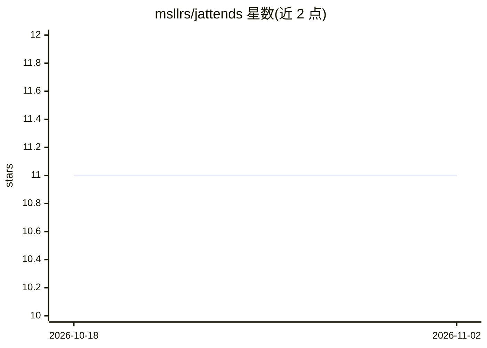

# msllrs/jattends

⭐ 11 · Swift · MIT · 推送 2026-10-26 · [GitHub](https://github.com/msllrs/jattends) · 个人维护

**macOS 菜单栏应用：监控 Claude Code 会话状态并快捷审批与跳转**

macOS menubar 应用，通过 Claude Code hooks 跟踪会话状态：当会话出现工具审批请求、等待输入或错误时，在菜单栏显示角标，可从通知或菜单直接 Approve/Deny，点击会话跳转到对应终端窗口/分面板（OSC 2 标题标记定位）。支持 Ghostty、iTerm2、Terminal.app、kitty、Warp 等多种终端。需 macOS 14+、Claude Code 与 Swift 5.10+，从源码克隆后经安装脚本构建安装。附 Raycast 扩展用于模糊搜索切换会话。

## 筛选速览

| 维度 | 判定 | 备注 |
|---|---|---|
| AI 角色 | `ai-ecosystem` | LLM/agent 周边工具 |
| 许可风险 | `permissive` | MIT |
| 部署形态 | `None` |  |
| 模型依赖 | — | README 未给出锁定关系 |
| 硬件要求 | — | 无带数字的原话,不猜 |
| 安装摩擦 | `low` | 无编译、无系统依赖或容器化 |
| 成熟度 | — | 结构信号不足 |

## 能力要点

- 从菜单栏/通知直接 Approve/Deny Claude Code 权限请求
- 实时会话状态：needs approval/waiting/error/working 等
- 点击跳转到精确终端窗口/分面板（OSC 2 标题标记）
- 支持 9 种终端与 Raycast 配套扩展

## 适用场景

- 同时跑多个 Claude Code 会话时统一查看哪些需要我处理
- 不打断当前工作直接审批 Claude Code 的权限请求
- 一键跳转到正在等待的会话所在终端分面板

## 场景标签

 · 领域:开发者工具/AI 会话管理

## 证据(README 行号)

> L19: Jattends uses Claude Code hooks to track session state. When something needs your attention — a tool approval, a qu
> L3: Jattends is a menubar app that tells you when your Claude Code sessions need attention.

## 星数曲线

2026-10-18 11 → 2026-11-02 11（+0）

---
*卡片 v1 · prompt 1.4 · 生成 2026-11-02 · 置信度 high · 依据 README sha `1ed66445b256` · [字段定义](../../DATASET.md)*
