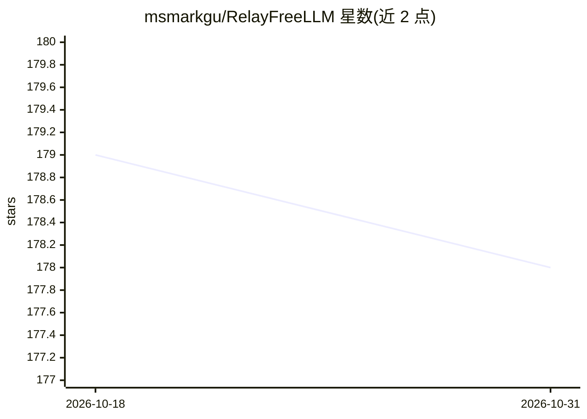

# msmarkgu/RelayFreeLLM

⭐ 178 · Python · MIT · 推送 2026-08-31 · [GitHub](https://github.com/msmarkgu/RelayFreeLLM) · [官网](https://gemlight.42web.io) · 个人维护

**聚合多家免费 AI 额度的 OpenAI 兼容网关，自动故障转移**

基于 FastAPI 的自托管 REST API 网关，将 Gemini、Groq、Mistral、DeepSeek、NVIDIA、Cerebras、Cloudflare、Ollama 等多个免费额度供应商聚合为单一 OpenAI 兼容接口。请求失败时按熔断器机制自动切换供应商；支持意图路由（按模型类型/规模/名称筛选）、4 种多轮上下文管理模式、会话亲和、图像感知路由与输出风格归一化。内置 /chat 网页聊天界面与 /admin 可视化管理面板，数据存 JSON 文件无需数据库。面向个人开发者、学生与自托管用户。

## 筛选速览

| 维度 | 判定 | 备注 |
|---|---|---|
| AI 角色 | `ai-ecosystem` | LLM/agent 周边工具 |
| 许可风险 | `permissive` | MIT |
| 部署形态 | `self-host` | docker 或自建部署 |
| 模型依赖 | local-ok | 支持本地模型 |
| 硬件要求 | — | 无带数字的原话,不猜 |
| 安装摩擦 | `low` | 无编译、无系统依赖或容器化 |
| 成熟度 | — | 结构信号不足 |

## 能力要点

- 多供应商免费额度聚合，单一 OpenAI 兼容端点，自动故障转移与熔断器
- 意图路由：按 model_type/model_scale/model_name 筛选，或直指 Provider/Model
- 4 种上下文管理模式（Static/Dynamic/Reservoir/Adaptive），Reservoir 用 TF 打分做抽取式摘要、无需 LLM 调用
- 内置 /chat 流式聊天界面与 /admin 可视化限额编辑与用量监控

## 适用场景

- 不改代码把现有 OpenAI SDK 指向本地端点，聚合免费额度避免 429 限流
- 把私有 Ollama 实例与云端免费额度混合使用
- 通过 Admin 面板实时管理各供应商模型限额与查看用量

## 场景标签

`模型网关` · 领域:Agent 开发

## 证据(README 行号)

> L5: Don't want to pay $$/month to use AI Models? RelayFreeLLM is an open-source gateway that combines **multiple free-ti
> L29: |**OpenAI-compatible**|Drop-in for your existing code. LangChain, LlamaIndex, any SDK.|

## 星数曲线

2026-10-18 179 → 2026-10-31 178（-1）

---
*卡片 v1 · prompt 1.4 · 生成 2026-10-23 · 置信度 mid · 依据 README sha `306377519d6a` · [字段定义](../../DATASET.md)*
