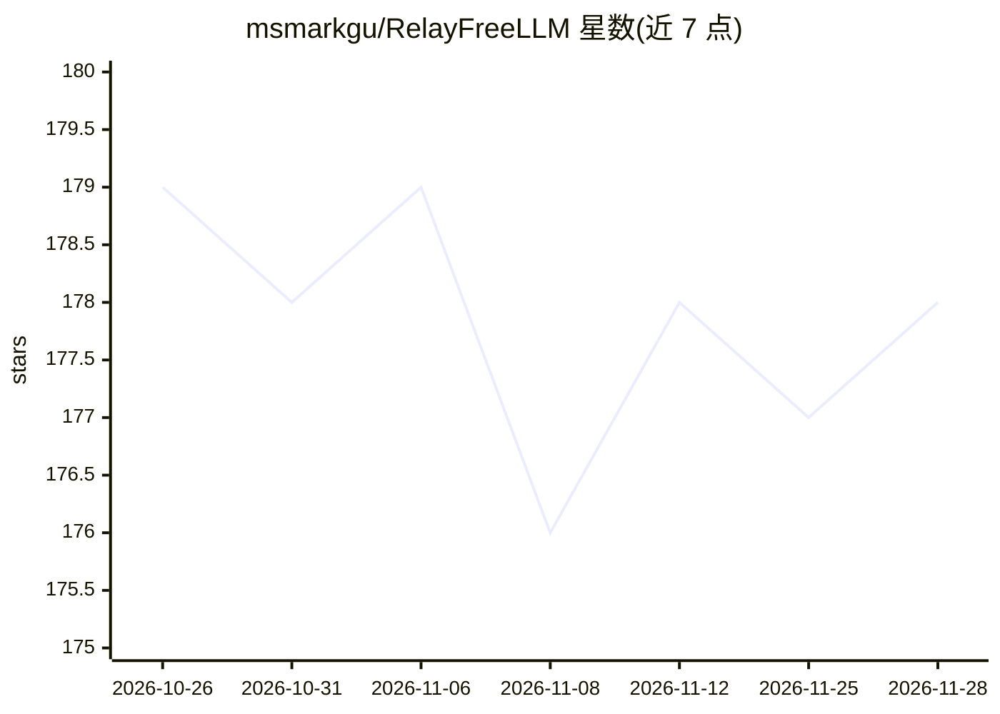

# msmarkgu/RelayFreeLLM

⭐ 178 · Python · MIT · 推送 2026-11-27 · [GitHub](https://github.com/msmarkgu/RelayFreeLLM) · [官网](https://gemlight.42web.io) · 个人维护

**开源 API 网关：将免费 AI 提供商聚合为单一 OpenAI 兼容端点**

基于 FastAPI 的本地网关，把一组策展的免费档模型提供商（默认启用 Groq、Gemini、Requesty、Kilo Gateway、DreamPrompting、Inferbase、Routeway 共 27 个模型）聚合在单个 OpenAI 兼容端点后，模型或提供商配额耗尽时自动故障转移。同时暴露 Anthropic Messages API，可为 Claude Code 等编程 agent 提供本地后端，支持工具调用、流式输出与模型别名映射。提供管理面板与聊天 Web UI、Bearer 鉴权、可用性检测脚本；安装通过 git clone + pip 或 Docker。

## 筛选速览

| 维度 | 判定 | 备注 |
|---|---|---|
| AI 角色 | `ai-ecosystem` | LLM/agent 周边工具 |
| 许可风险 | `permissive` | MIT |
| 部署形态 | `self-host` | docker 或自建部署 |
| 模型依赖 | local-ok | 支持本地模型 |
| 硬件要求 | — | 无带数字的原话,不猜 |
| 安装摩擦 | `low` | 无编译、无系统依赖或容器化 |
| 成熟度 | — | 结构信号不足 |

## 能力要点

- 单一 OpenAI 兼容端点聚合多个免费档提供商，自动故障转移
- 暴露 Anthropic Messages API，支持 Claude Code 一键启动脚本
- 附 /admin 用量管理面板、/chat 流式聊天页与可用性检测脚本
- 支持 provider/model 精确路由与 Bearer token 鉴权

## 适用场景

- 让已有 OpenAI SDK 代码免改动接入多个免费模型提供商
- 本地运行 Claude Code 而不注册 Anthropic 账户
- 个人开发环境统一管理多提供商的免费配额

## 场景标签

`模型网关` · 领域:Agent 开发

## 证据(README 行号)

> L5: Don't want to pay for AI APIs? RelayFreeLLM is an open-source gateway that combines free-tier providers behind a sin
> L18: The gateway also speaks the **Anthropic Messages API**, so coding agents like **Claude Code** can use the same loca

## 星数曲线

2026-10-26 179 → 2026-11-28 178（-1）

---
*卡片 v1 · prompt 1.4 · 生成 2026-11-28 · 置信度 high · 依据 README sha `0d70f3c31d15` · [字段定义](../../DATASET.md)*
