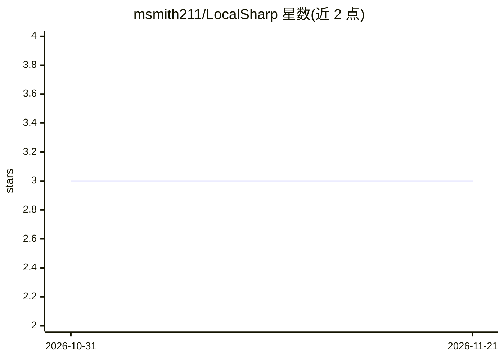

# msmith211/LocalSharp

⭐ 3 · C# · MIT · 推送 2026-10-30 · [GitHub](https://github.com/msmith211/LocalSharp) · [官网](https://www.nuget.org/packages/LocalSharp) · 个人维护

**.NET 开发者连接本地 LLM 服务器的客户端库**

基于 Microsoft.Extensions.AI 的 .NET 客户端库，用于对接本地 LLM 服务器（LM Studio、Ollama、llama.cpp、vLLM）。提供服务器自动发现、聊天与流式输出、模型列表、类型化结构化输出（JSON schema 或提示模式，含失败重试与错误回传）、依赖注入注册（AddLocalSharp）等能力，LocalSharpClient 直接实现 IChatClient。设计原则是不静默失败：不支持的选项在请求前抛出异常。目前 v0.1，仅 LM Studio 经过真实服务器测试，工具调用计划在 v0.2。

## 筛选速览

| 维度 | 判定 | 备注 |
|---|---|---|
| AI 角色 | `ai-ecosystem` | LLM/agent 周边工具 |
| 许可风险 | `permissive` | MIT |
| 部署形态 | `None` |  |
| 模型依赖 | local-ok | 支持本地模型 |
| 硬件要求 | — | 无带数字的原话,不猜 |
| 安装摩擦 | `medium` | 含编译或系统依赖之一 |
| 成熟度 | `idea` | |

## 能力要点

- LocalSharpDiscovery.FindAsync() 探测默认端口并识别后端类型
- GetAsync<T>() 类型化结构化输出，含回复清理与纠正性重试
- 直接实现 IChatClient，无缝接入 Microsoft.Extensions.AI 生态与依赖注入
- StrictModelMatching 可在服务器返回不同模型时抛出异常

## 适用场景

- 在 .NET 应用中接入本地 LM Studio/Ollama 服务器进行对话与流式生成
- 需要强类型结构化输出并容忍小模型格式错误的场景
- 自动发现局域网内运行中的本地 LLM 服务器

## 场景标签

 · 领域:LLM 基础设施/客户端库

## 证据(README 行号)

> L3: **A .NET client for local LLM servers (LM Studio, Ollama, llama.cpp, vLLM), built on Microsoft.Extensions.AI.**
> L32: LocalSharp complements those libraries rather than replacing them, and drops into the Microsoft.Extensions.AI ecosy

## 星数曲线

2026-10-31 3 → 2026-11-21 3（+0）

---
*卡片 v1 · prompt 1.4 · 生成 2026-11-21 · 置信度 high · 依据 README sha `f60a48214009` · [字段定义](../../DATASET.md)*
