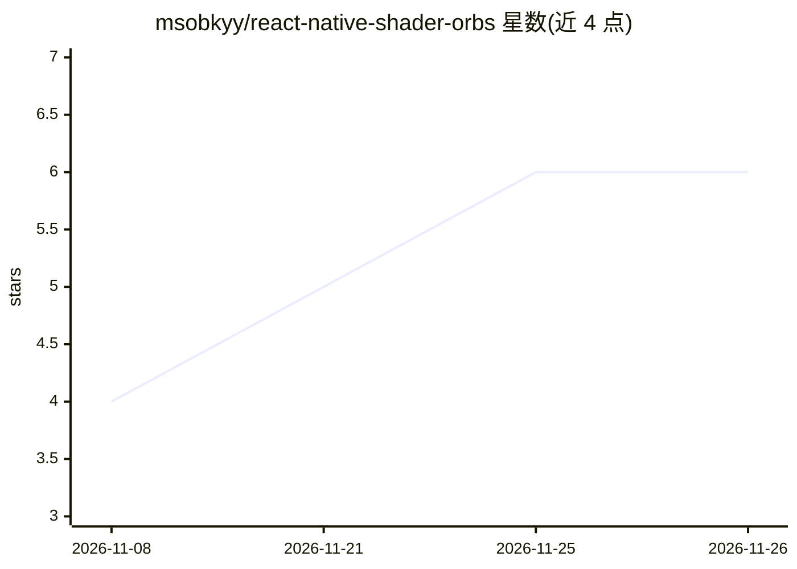

# msobkyy/react-native-shader-orbs

⭐ 6 · TypeScript · NOASSERTION · 推送 2026-11-01 · [GitHub](https://github.com/msobkyy/react-native-shader-orbs) · [官网](react-native-shader-orbs.vercel.app) · 个人维护

**为 React Native/Expo 开发者提供 33 个 WebGPU shader 球组件**

React Native 与 Expo 的 GPU shader 球组件库，提供 33 个 WebGPU shader，每个含类型化参数与 idle/thinking/speaking 三种状态切换，支持实时属性更新、触摸交互、音频音量驱动与自适应画质。需 development build（不支持 Expo Go），仅在 Android 一台设备上测试过，无 WebGPU 时显示空白且无降级。附带 MCP 服务器，可将参数文档接入 Claude Code、Cursor、VS Code 等编码助手。库代码为 MIT，shaders 限非商业使用。

## 筛选速览

| 维度 | 判定 | 备注 |
|---|---|---|
| AI 角色 | `ai-enhanced` | 去掉 AI 部分产品仍成立 |
| 许可风险 | `none` | NOASSERTION |
| 部署形态 | `library` | 以包/库形式分发 |
| 模型依赖 | — | README 未给出锁定关系 |
| 硬件要求 | — | 无带数字的原话,不猜 |
| 安装摩擦 | `low` | 无编译、无系统依赖或容器化 |
| 成熟度 | `idea` | |

## 能力要点

- 33 个 WebGPU shader 组件，参数类型化且范围校验
- idle/thinking/speaking 三种状态与弹簧过渡
- 音频音量输入驱动与触摸交互、自适应画质
- MCP 服务器一键配置编码助手参数知识

## 适用场景

- 为 AI 语音应用添加可视化状态球
- Expo 应用中嵌入可交互 GPU 动画组件
- 在 playground 调参后复制代码到项目

## 场景标签

 · 领域:移动开发/UI 组件库

## 证据(README 行号)

> L5:  GPU shader orbs for React Native and Expo.
> L64: It adds MCP config for Claude Code, Cursor and VS Code, a Claude Code skill, an `AGENTS.md` block and a Cursor rule

## 星数曲线

2026-11-08 4 → 2026-11-26 6（+2）

---
*卡片 v1 · prompt 1.4 · 生成 2026-11-21 · 置信度 high · 依据 README sha `4cb96bd3c12e` · [字段定义](../../DATASET.md)*
