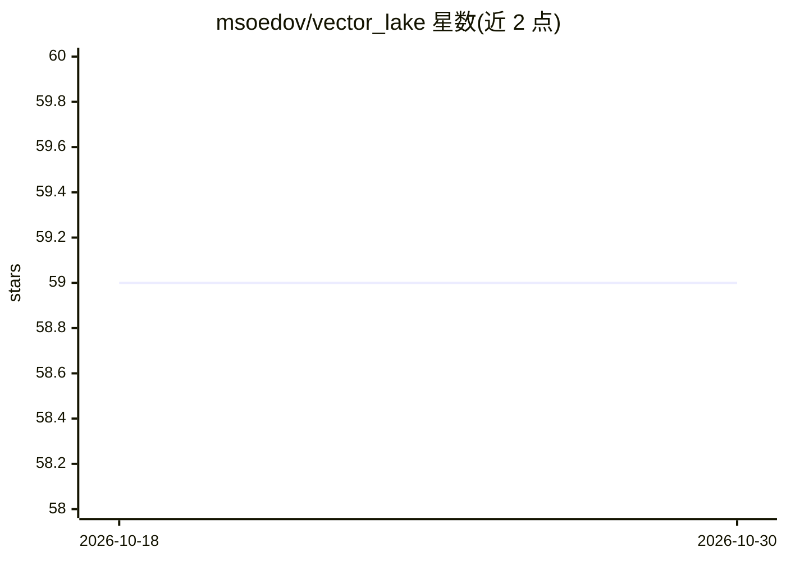

# msoedov/vector_lake

⭐ 59 · Python · MIT · 推送 2026-01-28 · [GitHub](https://github.com/msoedov/vector_lake) · 个人维护

**面向 LLM Agent 与 RAG 的 S3 向量数据库**

VectorLake 是一个以低维护、低成本为设计取向的向量数据库，将任意规模的向量数据以 S3 文件形式分布式存储，支持磁盘、网络卷与 S3 持久化。使用 HNSW 算法在各数据分片上做最近邻检索，支持自定义数据分区策略，并声明对 LLM Agent 原生支持，也可作为实验数据的特征存储。提供 LangChain 检索集成示例，pip 安装，MIT 许可，局限一节标注 TBD。

## 筛选速览

| 维度 | 判定 | 备注 |
|---|---|---|
| AI 角色 | `ai-ecosystem` | LLM/agent 周边工具 |
| 许可风险 | `permissive` | MIT |
| 部署形态 | `library` | 以包/库形式分发 |
| 模型依赖 | — | README 未给出锁定关系 |
| 硬件要求 | — | 无带数字的原话,不猜 |
| 安装摩擦 | `low` | 无编译、无系统依赖或容器化 |
| 成熟度 | — | 结构信号不足 |

## 能力要点

- 向量数据以 S3 文件分布式存储，支持磁盘/网络卷/S3 持久化
- 基于 HNSW 的最近邻检索
- 自定义数据分区策略
- 声明对 LLM Agent 原生支持，并可作为实验特征存储

## 适用场景

- 为 RAG 应用存储与检索 embedding
- 在 S3 上以低运维方式搭建向量检索
- 为 LLM Agent 提供向量存储后端
- 作为机器学习实验数据的特征存储

## 场景标签

`向量数据库` · 领域:知识与检索

## 证据(README 行号)

> L3: VectorLake is a robust, vector database designed for low maintenance, cost, efficient storage and ANN querying of an
> L28: - Native support of LLM Agents.
> L69: ## Langchain Retrieval

## 星数曲线

2026-10-18 59 → 2026-10-30 59（+0）

---
*卡片 v1 · prompt 1.4 · 生成 2026-10-24 · 置信度 high · 依据 README sha `5ac97743e912` · [字段定义](../../DATASET.md)*
